

 Once you understand how a network architecture is implemented, a natural question arises: how do I actually train a model like this? This section compiles all sorts of engineering know-how that answers that very question. 

## Preface

Large model architectures come in all shapes and sizes, but if you really want to understand one, you have to get your hands dirty. There are plenty of high-quality online courses on YouTube to learn from— [CS336: Language Modeling from Scratch](https://cs336.stanford.edu/) being a prime example—so this article essentially serves as my notes on CS 336. Here is my [code implementation](https://github.com/morethan987/cs336-assignment1-basics) and [Answers for Problems](https://github.com/morethan987/cs336-assignment1-basics/blob/main/Q%26A.md).

"Practice is the sole criterion of truth." 🫡

The content can be broadly divided into five parts:

1. [Fundamentals](): tokenizers, resource inventory, model architectures, training strategies
2. [Systems engineering](): kernels, parallelism, inference
3. [Scaling laws]()
4. [Data engineering](): benchmarking and pretraining data engineering. Messy, but absolutely critical
5. Model alignment: RL post-training fine-tuning

## Fundamentals

### Tokenizers

Karpathy has an excellent [video](https://youtu.be/zduSFxRajkE?si=X3hpizNlFcFiIXQt) on tokenizers that dives deep into everything you need to know about them.

Functionally speaking, a tokenizer is a peripheral component independent of the Transformer body. Its main job is to encode a long string of text into integers—the data type that Transformer models actually process: a sequence of integers.

A rather interesting question to ponder: from a low-level perspective, if the only goal is to map characters to integers, digitized text doesn't really need explicit encoding, because the vast majority of digital text is already UTF-8 encoded—these characters are natively represented as integers at the hardware level.

```python
>>> test_string = "hello, 世界！"
>>> utf8_encoded = test_string.encode("utf-8")
>>> print(utf8_encoded)
b'hello, \xe4\xb8\x96\xe7\x95\x8c\xef\xbc\x81'
>>> list(utf8_encoded)
[104, 101, 108, 108, 111, 44, 32, 228, 184, 150, 231, 149, 140, 239, 188, 129]
```

As you can see from the example above, a very short piece of text gets encoded into 16 integers—clearly far too granular. A Transformer's attention window is limited in size and extremely expensive, so the tokenizer's purpose is to chunk and aggregate this fragmented low-level encoding, thereby shortening the length of the integer sequence and improving the model's computational efficiency.

> [!NOTE] Food for thought
> A question worth exploring: assuming we had abundant compute, would training directly on raw UTF-8 sequences yield better results? Put another way, we could view the tokenizer as a simple spatial mapping that projects data from the noisy space of UTF-8 encoding into a more semantically meaningful space. We already know this mapping is effective—after all, every major LLM is trained this way—but how much does it actually improve things, and can we quantify that theoretically?

In terms of concrete algorithms, most models use the BPE algorithm that OpenAI originally adopted, with tiktoken being the representative library. Google's sentencepiece is also widely used across many large models, though configuring it is considerably more complex compared to tiktoken.

#### Detailed Questions

1. Why use bytes encoding instead of utf-8 encoding directly?

Ans: Actuall text data distribution on utf-8 encoding vocabulary is sparse while bytes encoding only has 256 vocabularies which means every vocabulary is amply sampled. However, bytes encoding is not perfect due to extremelly long seqeunce it produces, which is quite a burdon for model training.

2. Why pre-tokenize before BPE?

Ans: Original BPE needs to walk through whole corpus every merge leading to an overwhelming computational cost. Besides, there are some exact boundaries we don't expect the merging happen at, such as cross-word merging(e.g. "there" and "is" should be always two tokens) and trivial punctuations(e.g. dog! vs dog.).

3. How do you handle large datasets under memory constraints?

A: When training on massive datasets with limited RAM, the key is leveraging lazy-loading file reading mechanisms like `mmap` to effectively cap peak memory usage. When necessary, you should implement a full-pipeline streaming lazy-loading strategy—covering everything from file reading and encoding all the way to writing back to disk. Additionally, data structures and algorithms play a huge role in the tokenization stage; in my personal experience, priority queues and hash tables are the ones I rely on most.

### Resource Inventory

Broadly, available resources can be categorized as: per-unit-time compute capacity (FLOP/s), time, data volume, memory size, and the compute cost of tensor operations. The purpose of a resource inventory is to estimate training time—or the maximum model size you can train—given known resource constraints.

#### Memory Footprint

Almost all data is stored using tensors—arrays of floating-point numbers arranged according to certain rules. Depending on the floating-point format used, the memory footprint of model training or inference varies. In general, floating-point formats include the following:

1. float 32: 32-bit float, occupying 4 bytes of memory

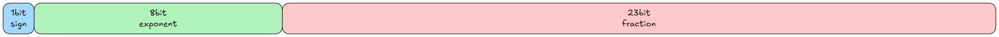

2. float 16: 16-bit float, occupying 2 bytes of memory. Its dynamic range is smaller than float 32, which can cause numerical underflow when gradients produced during backpropagation become very small. (This is precisely why bfloat 16 was introduced.)

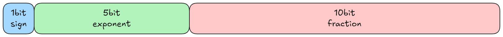

3. bfloat 16: brain floating point, also occupying 2 bytes. It sacrifices precision to expand the dynamic range, minimizing weird numerical overflow issues. (In deep learning, precision matters far less.)

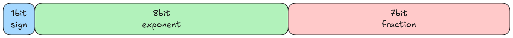

In practice, mixed-precision training is the norm: float 32 for optimizer states, bfloat 16 for parameters, activations, and gradients. Of course, there are more aggressive precision formats like float 8 and float 4, but they're generally not used for actual model training. And when float 4 is used, it doesn't directly represent a single parameter value; instead, neighboring parameters are packed together and share a scaling factor. This trick relies on the local similarity of parameters—adjacent parameters tend to have similar orders of magnitude, so you can factor out the shared scale and use a batch of low-precision numbers plus the scaling factor to represent a batch of high-precision numbers.

> [!NOTE] Difference from quantization
> Quantization aligns a model trained at high precision to a lower-precision space. It's considerably easier to pull off than training directly at low precision.

Here is a rough memory footprint estimation for an MLP. Assuming the input, activations, and output all have a fixed dimension \(D\), the layer count is \(L\), and the batch size is \(B\), the total parameter count can be estimated as \(D^2\cdot L\) —meaning \(L\) layers of \(D\times D\) square matrices. Parameter memory occupies \(2D^2\cdot L\) bytes assuming each parameter is stored in bf 16 format. Gradient memory usage is identical to parameters (since only parameters require gradients, and every parameter needs one gradient value). Optimizer states require \(4D^2\cdot L\) bytes because optimizer states generally use fp 32 to maintain precision (for instance, the \(g^2\) parameter in the AdaGrad optimizer acts as the **denominator** to regulate the learning rate, requiring higher precision). Finally, activation memory matches that of the parameters at \(2D^2\cdot L\) bytes.

> [!NOTE] Note
> Optimizer states vary depending on the optimizer; for example, the Adam optimizer allocates 8 bytes of memory per parameter to store the first and second momentum values.

Some methods to reduce memory footprint include gradient accumulation—where a `micro_batch_size` parameter is used to compute and accumulate gradients across \(\frac{\text{batch\_size}}{\text{micro\_batch\_size}}\) steps before updating parameters—and selective activation storage, where you might only keep pre-activation data instead of both pre- and post-activation data, recomputing post-activation values on the fly when needed. More aggressive strategies even omit caching across matrix multiplications, though this will undoubtedly slow down training speed.

---

Here is the detailed upper bound on the peak memory for several characteristic modules in Transformer. Since this is an upper bound estimation, we simply sum up all the data that needs to be retained during training (in actual execution, dynamic memory deallocation occurs, making the actual footprint smaller than the upper bound) and ignore optimizations that use recomputation to reduce memory (during gradient calculation, some intermediate variables are recomputed because the recomputation overhead is smaller).

Overall, peak memory can be divided into four parts: trainable parameters (weights), optimizer states (depending on the type of optimizer; AdamW is used by default below), gradients, and activations. The first three are easy to understand: trainable parameters are explicitly defined in the code; for the AdamW optimizer, each parameter requires first and second moments, which is twice the number of trainable parameters; and for gradients, every trainable parameter has a corresponding gradient. But what exactly are activations? Activations are the intermediate variables (such as input tensors) required during gradient calculation. They are tightly coupled with the gradient computation process, and dynamic recomputation mechanisms can be used to save memory; therefore, the output of each elementary operation is generally accounted for as an activation.

**RMSNorm**: Contains a trainable scaling parameter of size \(d_{\text{model}}\), the optimizer occupies \(2 \times d_{\text{model}}\) parameters, gradients require \(d_{\text{model}}\) parameters, and the activation only needs the input tensor, which is \(\text{batch\_size}\times \text{context\_length}\times d_{\text{model}}\).

**Multi-Head Self-Attention**: Assuming \(d_{k}=\frac{d_{\text{model}}}{\text{num\_heads}}\) by default, the trainable parameters are the three matrices \(W_{Q}\), \(W_{K}\), and \(W_{V}\), each having a shape of \(d_{\text{model}}\times d_{\text{model}}\); the optimizer states take twice the number of trainable parameters, i.e., \(6\times d_{\text{model}}\times d_{\text{model}}\) parameters; gradients match the trainable parameters with \(3\times d_{\text{model}}\times d_{\text{model}}\) parameters; activations include the input tensor \(\text{batch\_size}\times \text{context\_length}\times d_{\text{model}}\), the three projection tensors \(Q\), \(K\), and \(V\) (each being \(\text{batch\_size}\times\text{context\_length}\times d_{\text{model}}\)), the attention scores and softmax (both producing tensors of shape \(\text{batch\_size}\times \text{num\_heads} \times \text{context\_length}\times \text{context\_length}\), the quadratic term), the weighted linear sum \(\text{batch\_size}\times \text{context\_length}\times d_{\text{model}}\), and the output linear projection which is also \(\text{batch\_size}\times \text{context\_length}\times d_{\text{model}}\).

**FFN**: Generally \(d_{ff} = \frac{8}{3}\times d_{\text{model}}\), so the number of trainable parameters is \(3 \times (\text{d\_model} \times d_{ff}) = 8 \times \text{d\_model}^2\); gradients and optimizer states are \(8 \times \text{d\_model}^2\) and \(16 \times \text{d\_model}^2\), respectively; activations include the input tensor \(\text{batch\_size}\times \text{context\_length}\times d_{\text{model}}\) and the computed outputs of the three projection matrices \(3 \times (\text{batch\_size} \times \text{context\_length} \times \frac{8}{3} \text{d\_model}) = 8 \times \text{batch\_size} \times \text{context\_length} \times \text{d\_model}\).

#### Tensor Computation

Let's look at the computational cost of tensor multiplication, using the following diagram as an example.

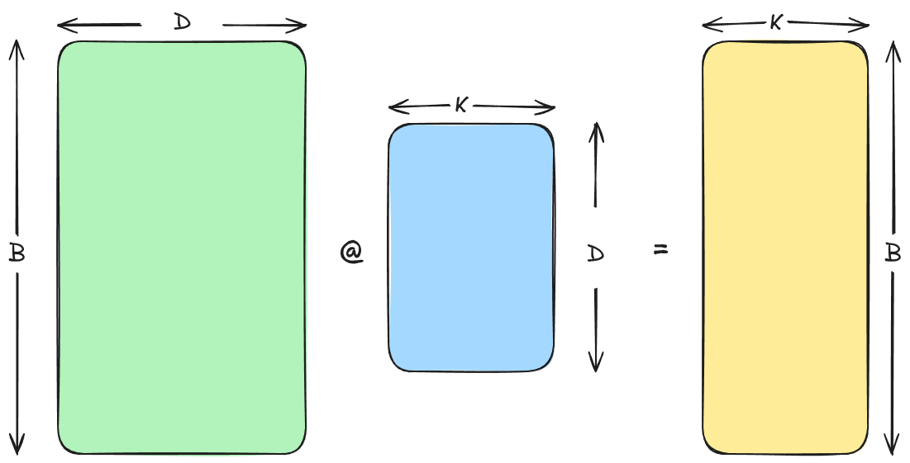

The total computational cost, in a nutshell: the resulting tensor has the shape \(B\times K\), giving us \(B\cdot K\) elements in total. Each element is the sum of \(D\) pairs of element-wise multiplications, meaning every element in the final result represents \(2D\) multiplication or addition operations. So the total computational cost is: \(2D\cdot B\cdot K\).

> [!NOTE] A clarification
> This is the simplest case, with no hardware-level optimizations factored in—for instance, all additions being fused into a single operation.

There's another important engineering metric to introduce here: MFU (Model FLOPs Utilization), which measures the actual compute utilization when the model is running. Simply put, in real-world engineering implementations, the GPU's total compute power is never 100% utilized—MFU captures that actual utilization rate.

During backpropagation, because gradients must be computed for both operands involved in the forward pass (the activations and the weights), the backward pass requires roughly twice as much compute as the forward pass.

### Model Architecture

As a model introduced back in 2017, the standard Transformer is, in a sense, showing its age—which is why Transformer models implemented in actual production are modernized variants. A high-level comparison of these modifications is shown below.


A noteworthy point in the final output stage is the shape of the output tensor. Empirically, one might expect the final result to be a probability distribution over the entire vocabulary, i.e., a tensor of shape \(\text{batch\_size}\times \text{vocab\_size}\). In reality, however, the output shape is \(\text{batch\_size} \times \text{seq\_len} \times \text{vocab\_size}\), which means that the distribution of the next token is predicted for every token position (this is precisely where the highly parallel training capability of the Transformer originates). You might wonder: wouldn't this be very wasteful during inference? In fact, inference only requires the probability distribution at the very last token position. Indeed, directly copying the training logic would be quite wasteful; however, inference utilizes KV Cache technology, so this waste only occurs when generating the **first** token. During subsequent token-by-token generation, the sequence length is directly kept fixed at 1, as there is simply no need to repeatedly feed the preceding sequence into the model.

#### Normalization

First, Post-Normalization was replaced by Pre-Normalization, which is far more beneficial for numerical stability. The key lies in removing normalization from the residual stream—Layer Normalization can be placed either before or after the linear module, or even applied as "Double-Norm".

Next comes the choice of normalization function. Early LLMs generally used the standard LayerNorm formulation, such as in GPT-1/2/3:


$$
y=\gamma\frac{x-E(x)}{\sqrt{ Var(x)+\epsilon }} + \beta
$$

More recent models, however, opt for RMSNorm, which completely eliminates the mean and bias terms:


$$
y=\gamma\frac{x}{\sqrt{ \left \| x \right \|_{2}^2 }}
$$

So why use RMSNorm? Because while there is virtually no difference in final training performance (with RMSNorm sometimes even performing slightly better), RMSNorm is noticeably faster. But why optimize this module in the first place? Mathematically, normalization accounts for a meager \(0.17\%\) of total FLOPs, making optimization seem unnecessary at first glance; in reality, however, normalization accounts for up to \(25.5\%\) of actual execution time due to heavy data movement overhead.

Finally, bias terms in linear layers are discarded. The original FFN layer expression was:


$$
\text{FFN}(x) = max(0, xW_{1}+b_{1})W_{2}+b_{2}
$$

However, modern implementations generally use:


$$
\text{FFN}(x) = \sigma(xW_{1})W_{2}
$$

The main reason for this change is to save memory and improve training stability. See the [Training Stability]() section for details regarding training stability.

#### Activation Functions

A wide variety of activation functions have emerged, but selecting the right one still requires careful consideration. Modern LLM models generally choose activation functions with gating mechanisms. The so-called gating mechanism is essentially an element-wise multiplication (Hadamard product, \(\otimes\)). Below is a concrete comparative example. The classic FF layer expression is as follows:


$$
\text{FF} = max(0, xW_{1})W_{2}
$$

In contrast, ReGLU adds a gating mechanism to the ReLU section using an additional set of parameters:


$$
\text{FF}_{\text{ReGLU}}(x, W_{1}, V, W_{2}) = (max(0, xW_{1})\otimes xV)W_{2}
$$

Each element of the parameter matrix \(V\) acts on the corresponding ReLU output, amplifying or attenuating specific activation values. Similarly, the expressions for GeGLU and SwiGLU activation functions are:


$$
\text{FF}_{\text{GeGLU}}(x, W_{1}, V, W_{2}) = (\text{GeLU}(xW_{1})\otimes xV)W_{2}
$$


$$
\text{FF}_{\text{SwiGLU}}(x, W_{1}, V, W_{2}) = (\text{Swish}(xW_{1})\otimes xV)W_{2}
$$

where \(\text{Swish}(x) = x\cdot\text{sigmoid}(x)\) is a foundational activation function similar to GeLU and ReLU.

Experiments ultimately show that gated activation functions are indeed effective. Although the gain is modest—such as a less than \(1\%\) improvement from ReLU's \(83.80\%\) to ReGLU's \(84.67\%\), this gain comes with virtually no extra cost (both VRAM and compute overhead are minimal). So why not enjoy a free lunch?

> [!NOTE] Note
> Because gated activation functions introduce an extra projection parameter matrix, the hidden dimensions of these projection matrices are typically set to \(\frac{2}{3}\) of non-gated activation functions to maintain parameter parity.

#### Layer Parallelism

Transformer blocks in standard LLMs are typically stacked sequentially, expressed as:


$$
y = x+\text{MLP}(\text{Norm}(x+\text{Attention}(\text{Norm}(x))))
$$

However, the GPT-J model proposed a parallel computation layout for Transformer modules:


$$
y = x + \text{MLP}(\text{Norm}(x)) + \text{Attention}(\text{Norm}(x))
$$

Although the GPT-J paper states that this parallel approach yields a \(15\%\) speedup in large-scale training with controllable quality loss at the 8 B scale and zero loss at the 62 B scale—making its impact on model quality largely neutral—the vast majority of models still stick to sequential Transformer blocks. After all, logically speaking, this parallel layout effectively cuts the depth of the model in half, which represents a rather risky architectural trade-off.

#### Positional Encoding

Currently, the most mainstream positional encoding technique is **Rotary Position Embedding** (RoPE), which is a relative positional encoding scheme independent of absolute token positions. Why do we need relative positional encoding? Because the attention mechanism in Transformers logically ought to depend only on the relative positions between tokens, rather than capturing absolute position information for logical inference.

Before RoPE, there were several relative position encoding schemes, but most of them suffered from drawbacks such as high computational overhead or being unfriendly to KV Cache implementations. The ideal relative position encoding: it can be applied to each token in an absolute position manner, and when calculating attention (inner product), it naturally becomes a function of relative position. What mathematical operation can satisfy both of these conditions? The answer is the rotation of 2D planar vectors, as shown in the figure below:

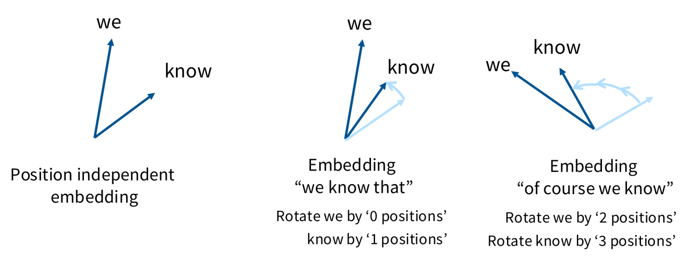

You might wonder: a 2D vector can obviously be rotated this way, but how do we rotate a high-dimensional vector? It is hard to imagine how a 4D vector should be rotated to satisfy the conditions above. In reality, however, we do not need to actually rotate a high-dimensional vector directly. Because the ultimate goal is to compute the inner product, we can simply group the components of the high-dimensional vector in pairs of two and treat each pair as a 2D planar vector. The specific mathematical formulation is as follows, introducing two index parameters: \(i\in\{0, 1, \dots ,\text{max\_seq\_len}-1\}\) denotes the absolute position index of the token (handling up to \(\text{max\_seq\_len}\) tokens), and \(k \in \{0,1, \dots ,\frac{d}{2}-1\}\) denotes the group index after partitioning the \(d\)-dimensional token embedding vector in pairs of two.


$$
\theta_{i,k} = \frac{i}{\Theta^{\frac{2k}{d}}}
$$


$$
R_k^i = \begin{pmatrix} \cos(\theta_{i,k}) & -\sin(\theta_{i,k}) \\ \sin(\theta_{i,k}) & \cos(\theta_{i,k}) \end{pmatrix}
$$


$$
R^i = \begin{pmatrix} R_1^i & 0 & 0 & \dots & 0 \\ 0 & R_2^i & 0 & \dots & 0 \\ 0 & 0 & R_3^i & \dots & 0 \\ \vdots & \vdots & \vdots & \ddots & \vdots \\ 0 & 0 & 0 & \dots & R_{d/2}^i \end{pmatrix}
$$

In practical code implementations, we generally do not directly store \(\text{max\_seq\_len}\) distinct \(R^i\) matrices. A better approach is to store the sine and cosine matrices separately; both are 2D dense matrices and can be reused globally. During computation, we transform the input and then directly apply element-wise multiplication. An intuitive example is rotating a 2D vector \([x_0, x_1]^\top\) by an angle \(\theta\):


$$
\begin{pmatrix} \cos\theta & -\sin\theta \\ \sin\theta & \cos\theta \end{pmatrix} \begin{pmatrix} x_0 \\ x_1 \end{pmatrix} = \begin{pmatrix} x_0 \cos\theta - x_1 \sin\theta \\ x_1 \cos\theta + x_0 \sin\theta \end{pmatrix}
$$

We can rewrite this in the form of element-wise multiplication:


$$
x \odot \cos(\theta) + \tilde{x} \odot \sin(\theta)
$$

where \(\tilde{x} = [-x_1, x_0, -x_3, x_2, \dots]\), which swaps adjacent elements in pairs and applies a negative sign; this result can be obtained using batched matrix/tensor operations.

#### Hyperparameter Selection

Hyperparameter selection generally revolves around these core questions:

1. How many times the model dimension \(d_{\text{model}}\) should the FF layer dimension \(d_{\text{ff}}\) be set to?
2. How should the number of attention heads be chosen? Should \(d_{\text{model}} = d_{\text{head\_num}} \cdot d_{\text{head}}\) strictly hold?
3. How should the aspect ratio between model width and depth be determined?
4. How should the vocabulary size be chosen?
5. Is regularization necessary to prevent overfitting when the data volume far exceeds the parameter count?

First, the relationship \(d_{\text{ff}} = 4d_{\text{model}}\) holds true for the vast majority of current models, with very few exceptions. For example, in GLU-variant FF layers, due to the third projection matrix introduced, \(d_{\text{ff}}\) is set to \(\frac{2}{3}\) of the standard size, giving \(d_{\text{ff}} = \frac{8}{3}d_{\text{model}}\) in this family—which in a sense isn't even a true exception. The real outlier is Google's T 5 model, which uses an exaggerated \(d_{\text{ff}} = 64d_{\text{model}}\), though the paper explains this choice was driven by TPU utilization considerations.

As for the number of attention heads, \(d_{\text{model}} = d_{\text{head\_num}} \cdot d_{\text{head}}\) holds true almost all the time, with the main exceptions again being certain Google models.

> [!NOTE] Detailed Explanation
> You might wonder: if \(d_{\text{model}} \neq d_{\text{head\_num}} \cdot d_{\text{head}}\), wouldn't the token embedding dimension change? How could it then be fed into the next Transformer Block? To resolve this issue, we simply wrap the final output with an additional linear layer \(W_{O}\) to project the output dimension back to \(d_{\text{model}}\). Furthermore, another purpose of \(W_{O}\) is to mix the representations produced across different attention heads; therefore, a \(W_{O}\) layer is applied even when \(d_{\text{model}} = d_{\text{head\_num}} \cdot d_{\text{head}}\).

Regarding the aspect ratio (width vs. depth), extensive empirical data indicates that \(d_{\text{model}}/n_{\text{layer}} \approx 128\) is a sweet spot. Models are not strictly better the deeper they get; extremely deep models are notoriously hard to parallelize and suffer from high latency.


Vocabulary size depends on whether the model is monolingual or multilingual: monolingual models typically use 30–50 k, while multilingual vocabularies reach 100–250 k. As a side note, Transformers with multimodal generation capabilities feature even larger vocabularies.


On overfitting and regularization: logically, overfitting shouldn't be a concern when data scale vastly exceeds parameter count, as overfitting rarely occurs under these conditions. SGD-style optimizers perform only a single pass over the corpus, making it hard for the model to memorize text snippets. Indeed, Dropout has largely been phased out. However, weight decay has been retained: although weight decay yields worse results in most cases compared to no decay, combining it with a small dynamic learning rate ultimately outperforms non-decayed setups (as seen in the bottom-right of the second figure below, where the blue dashed line achieves the optimal training loss).

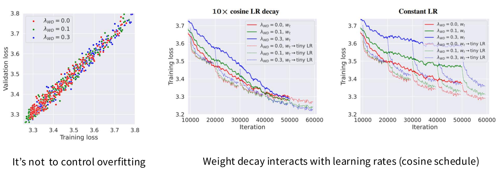

#### Training Stability

What is training stability? It might sound a bit abstract, but the figure below illustrates it well: although the blue curve achieves lower loss, it frequently exhibits severe spikes—meaning you might end up with a terrible model when training completes. The blue curve is a classic sign of training instability.


Where does this training instability come from? A prime suspect is the softmax layer at the model's output. Because softmax is shift-invariant, the optimizer has zero incentive to keep the absolute magnitude of the scoring function (logits) in check, paving the way for numerical overflow. Here is what standard cross-entropy loss looks like:


$$
\begin{aligned} \text{Loss} &=-\sum_{i}^{L} \left[ \log(P(x_i)) \right] \\ &=-\sum_{i}^{L} \left[ \log\left(\frac{e^{U_r(x_{i})}}{Z(x_{i})}\right) \right] \\ &=-\sum_{i}^{L} \left[ U_r(x_{i}) - \log(Z(x_{i})) \right] \end{aligned}
$$


$$
Z(x)=\sum_{r'=1}^{|V|} e^{U_{r'}(x)}
$$

Here, \(U_{r}\) represents the scoring function (logits), \(|V|\) denotes the vocabulary size, and \(L\) is the sequence length. While the cross-entropy formulation might look a bit intimidating, stripping away the negative sign reveals that it is simply the log-likelihood. To explicitly force the optimizer to rein in the exponential terms, an intuitive fix is to penalize their sum—the partition function \(Z(x)\). This motivates adding a regularization term known as Z-loss into our objective:


$$
\begin{aligned} \text{Loss} &=-\sum_{i}^{L} \left[ \log(P(x_i)) -\alpha(\log(Z(x_i))-0)^2 \right] \\ &=-\sum_{i}^{L} \left[ U_r(x_{i}) - \log(Z(x_{i})) -\alpha\log^2(Z(x_i)) \right] \\ &=\sum_{i=1}^{L} \Big[ \underbrace{\log(Z(x_i)) - U_r(x_i)}_{\text{Cross-Entropy}} + \underbrace{\alpha \log^2(Z(x_i))}_{\text{Z-loss}} \Big] \end{aligned}
$$

You might wonder: why penalize the squared logarithm rather than a straightforward \((Z-1)^2\)? There is a subtle and easily overlooked detail here: \(Z\) must reflect its true absolute value, meaning we cannot bypass it with the standard max-subtraction trick (any subtracted constant must eventually be restored), as this is inherently required by the regularizer itself. In other words, when handling absolute magnitudes, working in the log domain is essential to convert exponential blowups into manageable additions—evaluating \((Z-1)^2\) directly would trigger numerical overflow in an instant:


$$
\log(Z) = m + \log\left( \sum e^{U_{r} - m} \right),\ m=\text{max}(U_{r})
$$

Second is the instability within the attention module's Softmax. However, the solution here isn't to modify Softmax directly, but to apply Normalization to the QK inputs—the widely known "QK Norm" method. In standard Transformer attention, Q and K undergo an inner product immediately after computation; "QK Norm", on the other hand, normalizes Q and K before computing their inner product, ensuring the values fed into Softmax remain on a far more consistent scale.

#### Attention Overhead During Inference

Most of our previous discussion focused on model training. However, when deploying models, we must consider inference-time overhead—most notably, the attention computational cost. Let us define an attention module where \(d\) is the model hidden dimension, \(b\) is the batch size, \(n\) is the input sequence length, \(h\) is the number of attention heads, and \(k=\frac{d}{h}\) is the head dimension.

Let us first analyze the arithmetic operations of the attention module during training. The input \(X\) has shape \(b\times n\times d\), and each head projection matrix has shape \(d\times k\), so the QKV projection FLOPs equal \(3\times(b\cdot n\cdot d\cdot k)\times h = 3bnd^2\). Next, computing the inner product of Q and K (both of shape \(b\times n\times k\)) takes \(bhkn^2 = bdn^2\) operations. While there are subsequent computations, they are non-dominant for large \(d\) and \(n\), so we can simply represent the computational complexity of the attention module as \(O(bnd^2+bdn^2)\).

Memory cache usage during training is straightforward to compute: first, matrices like input and QKV of shape \(b\times n \times d\) require \(O(bnd)\) memory access; then Softmax requires \(O(bhn^2)\) cache access, and weight parameters require \(d^2\) cache access, leading to a total memory access complexity of \(O(bnd+bhn^2+d^2)\).

Thus, the arithmetic intensity of the training attention module is \(O\left( \left( \frac{1}{d+n}+\frac{hn}{d^2+dn}+\frac{d}{bnd+bn^2} \right)^{-1} \right)\), which clearly becomes increasingly compute-dense as sequence length \(n\) grows.

Inference, however, is fundamentally different because tokens must be generated sequentially. In inference, we introduce KV Cache to avoid redundant computations, keeping computational complexity at \(O(bnd^2+bdn^2)\), but driving memory access complexity up to \(O(bn^2d+d^2)\).

The arithmetic intensity converges toward 1 as sequence length \(n\) grows—an extremely low intensity considering a fully loaded A 100 has an arithmetic intensity of around 156. In other words, LLM inference is a classic memory-bound task.

To reduce memory bandwidth intensity, we can employ Grouped-Query Attention (GQA), which groups query heads together so that heads in the same group share a single set of KV Cache. Denoting the number of groups as \(g\), GQA reduces memory access complexity to \(O\left( \frac{1}{g}bn^2d+d^2 \right)\).

Another technique for reducing attention computational complexity is grouped sliding-window attention. Simply put, full attention across the entire sequence is computed only once every four attention layers, while intermediate layers only compute attention over tokens within a fixed sliding window.

#### Attention Mechanism

There are two main optimization approaches for attention mechanisms: keeping the \(O(n^2)\) complexity while optimizing constants, or fundamentally redesigning the mechanism to achieve linear \(O(n)\) complexity. The former works remarkably well when context lengths aren't exceptionally long (say, under 2 M tokens)—take ChatGPT's local sliding-window attention as an example. Alternatively, you can push constant-factor optimization to the extreme through hardcore systems engineering; FlashAttention is a prime example here, reaching roughly 4 x the speed of standard PyTorch implementations.

However, if we want to process even longer input sequences, we have to tackle the \(O(n^2)\) complexity directly and reduce it to \(O(n)\). The core idea stems right from the standard quadratic attention formula:


$$
\text{Attn(Q,K,V)} = \text{softmax}(QK^T)V
$$

If the softmax function could be omitted, attention would naturally become linear. Below is the batched expression, which is convenient for training:


$$
\text{Attn(Q,K,V)} = (QK^T)V = Q(K^TV)
$$

We can also express it in a recurrent form for inference, which looks strikingly similar to an RNN:


$$
\begin{matrix} S_{t} = S_{t-1} + k_{t}v_{t}^T \\ y_{t} = q_{t}^TS_{t} \end{matrix}
$$

Linear attention layers are indeed deployed in real-world models. For instance, MiniMax-M 1 adopts a hybrid setup with 7 linear attention layers paired with 1 quadratic attention layer, balancing the recall issues of pure linear attention against the heavy compute costs of pure quadratic attention. To give you a clearer picture of the recall loss brought by linear attention, here is a figure from ByteDance's survey paper on hybrid linear attention:


As seen in the right chart, pure linear attention suffers a steep decline in recall. Curiously, the left chart shows that some pure linear attention models actually outperform standard quadratic attention in language capabilities (note that the model evaluation score here is a composite metric of perplexity and benchmarks). This suggests that pure recall tasks aren't fully aligned with real-world language tasks, where exact recall isn't always strictly required. Another practical takeaway from the right chart is that a 3:1 hybrid ratio achieves recall performance on par with standard attention—which explains why this 3:1 hybrid scheme is so widely used in practice.

Building on the recurrent formulation of linear attention, we can add a memory decay factor \(\gamma_{t} = f(x_{t})\) to clear out stale memory states, along with a gated output term \(v_{t}^TD\) (allowing certain information to bypass state compression and output directly). This gives us the Mamba-2 formulation. The Mamba family is undoubtedly one of the most famous linear attention designs out there; in Nemotron-3, it is combined with standard attention in a 3:1 ratio, delivering superior performance compared to pure linear setups.


$$
\begin{matrix} S_{t} = \gamma_{t} S_{t-1} + k_{t}v_{t}^T \\ y_{t} = q_{t}^TS_{t} + v_{t}^TD \end{matrix}
$$

Applying a directional Delta correction to the Mamba-2 expression, along with an input gate \(\beta_{t} = f(x_{t})\) for new memory entries, yields the Gated DeltaNet formulation:


$$
\begin{matrix} S_{t} = \gamma_{t} (I-\beta_{t}k_{t}k_{t}^T) S_{t-1} + \beta_{t}k_{t}v_{t}^T \\ y_{t} = q_{t}^TS_{t} \end{matrix}
$$

Here, \((I-\beta_{t}k_{t}k_{t}^T)\) erases parts of the state related to the current \(k_{t}\), making room for the new memory item \(\beta_{t}k_{t}v_{t}^T\). The largest-scale application of this approach is the Qwen-3.5 model—though again, it uses a 3:1 hybrid format rather than pure linear attention to get the best of both worlds. A clear trend emerges: linear attention mechanisms are gradually converging toward LSTM-like architectures.

Besides hidden-state approaches, another route is sparse activation, best exemplified by DSA (DeepSeek Attention). DSA uses a lightweight index to compute and retrieve the Top-k most relevant tokens, keeping the costs of \(O(n^2)\) attention manageable. This mechanism is adopted in both DeepSeek-v 3.2 and GLM-5, yielding impressive real-world results.

> [!NOTE]- A Side Note
> While benchmark scores look great on paper, in practical use you'll notice severe context-constraint forgetting. Personally, I don't feel fully confident delegating highly complex tasks to DeepSeek models—if you audit their outputs closely, you'll find they often fail to follow constraints mentioned earlier in the prompt. In short, it can feel a bit clunky 🤔, especially when compared side-by-side with Anthropic's models.

#### MoE

Mixture of Experts (MoE) is currently one of the most mainstream architectural paradigms. It allows scaled-up models to run with manageable compute costs, reaping the performance gains of parameter expansion while keeping inference costs in check—a true win-win. Of course, MoE wasn't an instant hit; its architecture and training balance are notoriously tricky to tune. In a sense, MoE represents less of a pure algorithmic leap and more of a major win for LLM systems engineering.

MoE can be applied to either Feed-Forward (FF) layers or Attention layers, but virtually all implementations focus on FF layers. By default, "MoE" refers to FF-layer MoE, a convention we'll follow here.

MoE consists of a few key components: routing functions, expert count, and training objectives. Routing functions and expert counts are straightforward, but training objectives serve a dual purpose: training the language model itself and maintaining routing balance so every expert receives adequate training.

Common routing functions include Top-k and Hash routing, alongside RL-based routing policies that frame load balancing as a linear assignment problem. Among these, Top-k is by far the most popular. Its mathematical formulation is as follows:


$$
h_t^l = \sum_{i=1}^{N} \left( g_{i,t}\operatorname{FFN}_i(u_t^l) \right) + u_t^l
$$


$$
g_{i,t} = \begin{cases} s_{i,t}, & s_{i,t}\in \operatorname{TopK} \left( \{s_{j,t}\mid 1\le j\le N\}, K \right),\\ 0, & \text{otherwise}, \end{cases}
$$


$$
s_{i,t} = \operatorname{Softmax}_i \left( (u_t^l)^T e_i^l \right)
$$

While this wall of math might look daunting, plain English puts it simply: the input \(u_{t}^l\) takes the inner product with each expert's key vector \(e_{i}^l\), followed by softmax normalization to obtain a matching probability distribution. Next, the gating function \(g_{i,t}\) selects the Top-k experts and zeroes out the rest (a batching trick that avoids conditional branching when calculating \(h_{t}^l\)). From there, standard feedforward computation takes over, aggregating expert outputs via simple summation before adding the residual connection.

Taking things a step further, experts can be split into finer sub-experts alongside dedicated shared parameters. This allows non-shared experts to specialize further, achieving better ensemble effects. This design is widely known as the DeepSeekMoE architecture.


Logically, both shared and non-shared experts should contribute to model performance. However, ablation studies from OLMoE reveal that performance gains actually stem from finer partitioning of non-shared experts, rather than the shared experts themselves.


The exact expert division ratios across architectures are detailed in the table below, which also highlights that DeepSeek-v 1 was indeed the pioneer in granular expert re-segmentation.

Model | Routed | Active | Shared | Fine-grained ratio
:----- | :-----: | :-----: | :-----: | :-----:
GShard | 2048 | 2 | 0 | -
Switch Transformer | 64 | 1 | 0 | -
ST-MOE | 64 | 2 | 0 | -
Mixtral | 8 | 2 | 0 | -
DBRX | 16 | 4 | 0 | -
Grok | 8 | 2 | 0 | -
DeepSeek v 1 | 64 | 6 | 2 | 1/4
Qwen 1.5 | 60 | 4 | 4 | 1/8
DeepSeek v 3 | 256 | 8 | 1 | 1/14
OLMoE | 64 | 8 | 0 | 1/8
MiniMax | 32 | 2 | 0 | ~1/4
Llama 4 (maverick) | 128 | 1 | 1 | 1/2

Finally, let's look at MoE training. The primary obstacle in MoE training is that the routing function is non-differentiable and inherently prone to instability. Early attempts tried modeling routing as an RL task with little success; adding noise to Top-k sampling improved stability, but at a slight cost to performance. Currently, the most effective solution is a regularization-like approach that introduces a heuristic load-balancing auxiliary loss:


$$
\text{loss} = \alpha \cdot N \cdot \sum_{i=1}^{N} f_i \cdot P_i
$$


$$
f_i = \frac{1}{T} \sum_{x \in \mathcal{B}} \mathbb{1}\{\operatorname{argmax} p(x) = i\}
$$


$$
P_i = \frac{1}{T} \sum_{x \in \mathcal{B}} p_i(x)
$$

Here, \(f_{i}\) denotes the actual proportion of tokens assigned to expert \(e_{i}\), while \(P_{i}\) represents the routing function's target probability for \(e_{i}\). This formulation uses the non-differentiable \(f_{i}\) to guide the differentiable \(P_{i}\), applying gradient penalties to unbalanced allocations:


$$
\frac{\partial \text{loss}}{\partial p_i(x)} = \frac{\alpha N}{T^2} \sum_{x \in \mathcal{B}} \mathbb{1}_{\operatorname{argmax} p(x) = i}
$$

Empirical results confirm that this heuristic approach works remarkably well, effectively balancing load across experts. Standard DeepSeekMoE further supplements this with device-level load-balancing regularization.


The later DeepSeekMoE-v 2 built upon this by introducing a Top-M device routing mechanism and inter-device communication penalty terms to curb communication overhead. To be honest, this adds quite a lot of regularization terms—it's effective, but arguably ungraceful. DeepSeekMoE-v 3 attempted to remove these loss terms by introducing dynamic bias terms, though it didn't eliminate them entirely.

Of course, training stability and fine-tuning in MoE differ markedly from standard dense FF modules—and frankly, are much trickier. Training instability largely stems from the softmax function in routing (nine out of ten instability issues trace back to softmax 🤣), which can be mitigated using the Z-loss method covered in the [Training Stability]() section. On the fine-tuning front, MoE models are far more prone to overfitting on small datasets than dense counterparts. DeepSeek's remedy? Fine-tune with massive datasets.

Overall, MoE carries a heavy systems engineering flavor—which brings us back to my point at the start: MoE's true impact shines brightest in systems engineering. At its core, MoE uses pragmatic engineering tricks to push the boundaries of scaling laws, giving us a straightforward path to continue squeezing performance out of sheer model scale.

## Systems engineering

The core of this section is grasping the fundamental mechanics of modern GPUs and leveraging these insights to guide model architecture choices and algorithmic breakthroughs. On the architecture front, a prime example is the NanoGPT Speedrun project, where the single most dramatic speedup came from simply padding the model's vocabulary size up to the nearest multiple of 64.

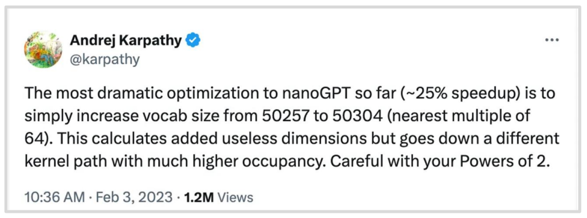

On the algorithmic side, FlashAttention is the undisputed poster child—its performance gains are measured in integer multiples rather than mere percentages.

### GPU Architecture

A GPU’s internal architecture and scheduling mechanics can be neatly unpacked through two orthogonal lenses: the "Programming & Memory Perspective" and the "Hardware & Scheduling Perspective." The programming and memory view breaks down as follows:

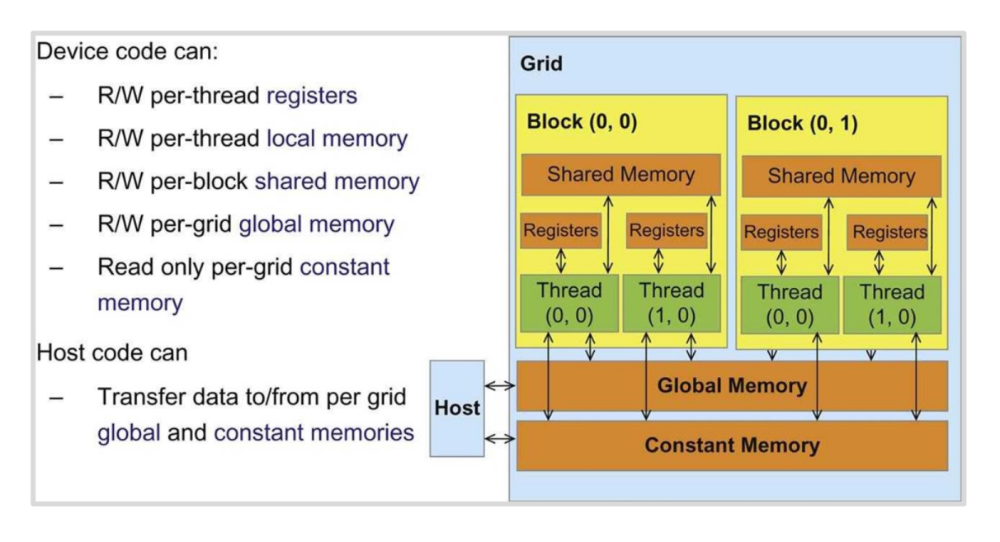

1. Thread: The fundamental unit of parallel execution; all threads run identical instructions across different slices of input data.
2. Block: A cluster of threads designed to collaborate and communicate through fast shared memory.
3. Grid: A collection of blocks coordinated via shared global memory and static memory.
4. Host: The CPU host and its system memory. Data moves between host memory and GPU VRAM across PCIe; because of bandwidth and latency penalties, cross-host communication and data transfers are notoriously expensive.

From the hardware and scheduling perspective, the following concepts take center stage:

1. SM (Streaming Multiprocessor): The GPU's primary physical compute engine, equipped with its own warp schedulers, register files, shared memory, and execution pipelines to host and execute thread blocks.
2. Warp: The lowest-level physical execution unit on hardware, strictly fixed at 32 threads. The distinction from a block is crucial: blocks are logical abstractions defined by developers with flexible sizes, but the hardware slices them into warps where all 32 threads execute scheduler instructions in lockstep; the primary purpose of warps is latency hiding via zero-overhead context switching (e.g., when Warp 0 stalls on memory reads, the scheduler immediately fires compute instructions from Warp 1).
3. Wave: The macro-level scheduling batch across the entire device, representing the maximum number of blocks that all SMs on the chip can concurrently execute; the GPU dispatches and completes work strictly in complete wave increments.

Intuitively, GPU architecture mirrors classic CPU paradigms, so anyone with computer architecture foundations will feel right at home with the multi-tier cache hierarchy. Similarly, TPU and GPU designs share substantial DNA, with direct conceptual equivalents across both camps. The real divergence lies in TPUs featuring leaner control units, massive matrix multiplication units (MXUs), and ultra-fast L 1 scratchpads (Shared Memory in GPUs vs. Vector Memory in TPUs).

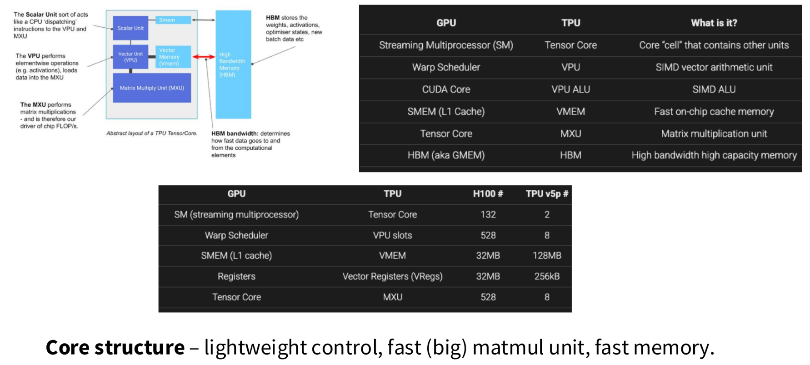

Across GPU generations, different subsystems evolve at vastly disparate rates: arithmetic compute capability has scaled exponentially faster than cache and memory bandwidth, as charted below. This is precisely why modern systems engineering obsesses over memory hierarchy optimizations—compute is so far ahead of memory loading that eliminating a single memory round-trip can unlock a 10,000 x (or even higher) boost in operational throughput.

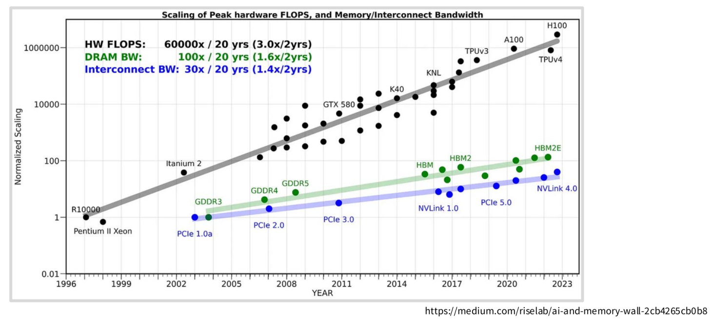

### Optimization Techniques

#### Branch Control

In short: replace branching (if-else) instructions with masks. This necessity stems from the core SIMT constraint: every thread within a warp must follow identical instructions. When conditional paths diverge on different data, conflicting execution requirements emerge. The hardware’s brute-force resolution is straightforward: both branches get executed sequentially, and unselected results are masked and thrown away.

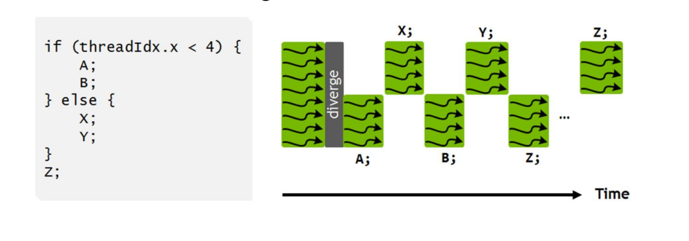

#### Low-Precision Computing

The premise is straightforward: trade numeric precision for massive data throughput. Pushing training to sub-byte levels, however, requires clever tricks. The prevailing industry standard groups low-precision values under a shared scaling factor, best exemplified by the MXFP 8 format. Yet this introduces a notorious headache: how do you handle transpositions? Because values are blocked and scaled row-wise, transposing swaps rows to columns, shattering the original scale-factor layout. There is no truly elegant in-place workaround, so training pipelines typically just duplicate and maintain a dedicated transposed copy of the tensor in memory.

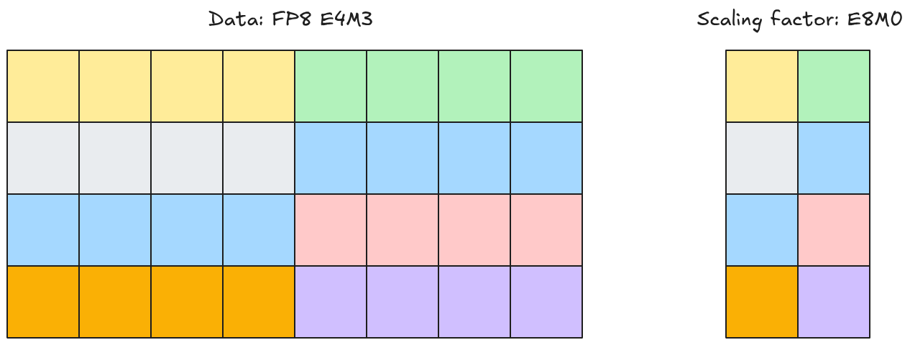

Another promising angle omitted in Stanford's CS 336—likely due to its complexity and lack of battle-testing in production-grade frontier models—is detailed in this [paper](https://arxiv.org/abs/2509.00404), which achieved end-to-end FP 4 training on an 8 B LLM. Prior to this, NVIDIA possessed internal FP 4 training recipes but kept the blueprints proprietary. The authors reverse-engineered NVIDIA’s technical blog posts by simulating FP 4 training mechanics via BF 16, meticulously matching target precision, training loss curves, and convergence dynamics in an impressively rigorous baseline study.

At its core, this research tackles a fundamental dilemma: neural network weights exhibit wide dynamic ranges, meaning naive scaling-factor quantization squashes subtle values under large outliers (classic quantization error), as an inflated dynamic range widens the quantization grid steps and collapses tiny near-zero values straight to zero. Intuitively, dominant outliers and subtle residuals demand decoupled representations. The authors achieve this by decomposing weight matrices via SVD, where \(\sigma_{i}\) denotes descending singular values:


$$
M = \sum_{i=1}^{r} \sigma_i \cdot (u_i v_i^T)
$$

Experimental results reveal that roughly the top 3% of singular values dominate the upper bound of the magnitude distribution (spanning one to two orders of magnitude). Stripping away these few dominant singular values leaves a residual matrix with an exceptionally flat, uniform distribution ready for tight quantization grids, while the isolated dominant components naturally compress into a shared scale factor coupled with well-behaved singular vectors—making it uniquely tailor-made for FP 4 quantization.

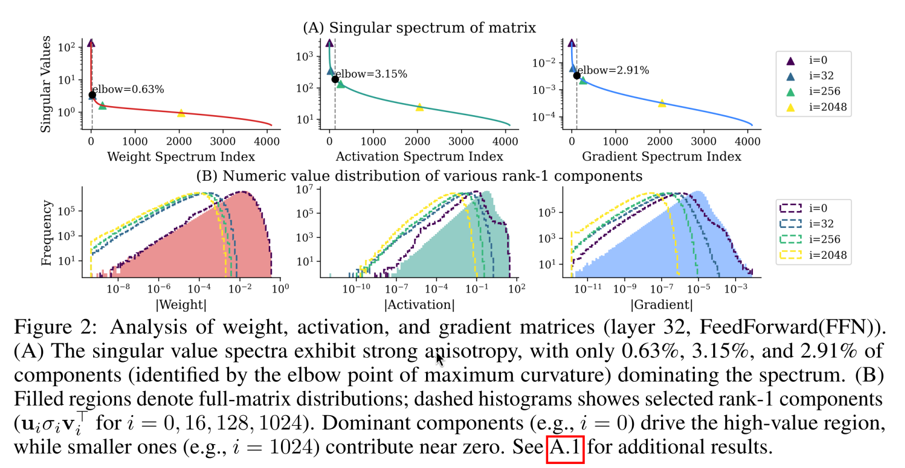

It’s worth highlighting that SVD-driven quantization wasn't invented in a vacuum; an earlier precursor was [SVDQuant](https://arxiv.org/abs/2411.05007). While both leverage SVD, SVDQuant feels somewhat unpolished in practice, shuttling high-precision matrices back and forth and wrestling with sparse matrix multiplication overheads, whereas the newer paper cleanly absorbs the heavy lifting directly into scaling factors and singular vectors.

#### Operator Fusion

Fusing multiple kernel operations into a unified pass avoids repeatedly ping-ponging intermediate tensors to and from HBM, slashing memory access overhead—this serves as the absolute cornerstone of FlashAttention. The diagram below captures the rationale intuitively: load data once, churn through as many arithmetic operations as possible locally, and avoid premature write-backs.

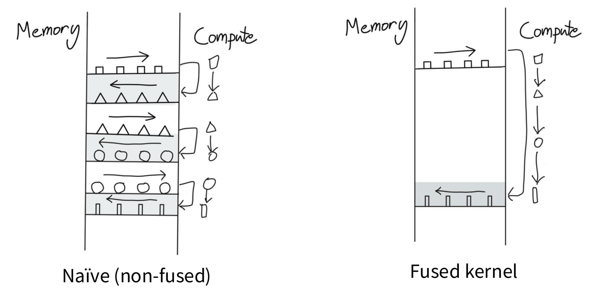

#### Recomputation

Literally what it says on the tin: discard intermediate activations instead of parking them in cache, and recompute them on the fly from primary inputs during the backward pass. In the toy workflow illustrated below, this clever trade-off slashes 8 memory accesses down to just 5.

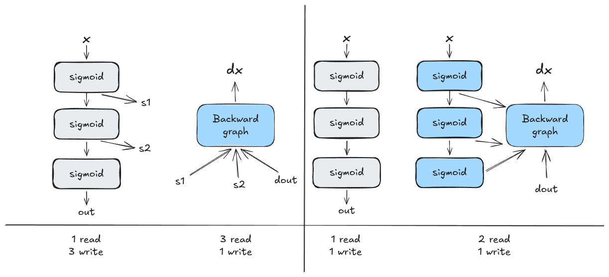

#### Memory Coalescing

This optimization taps into raw silicon mechanics: global memory (DRAM) accesses are wide and concurrent, meaning memory controllers must activate and pull an entire DRAM row buffer into staging before selecting target bytes. In other words, you pay the full latency and power cost of fetching a wide memory segment regardless; your only leverage is coalescing concurrent thread requests to consume as much of that pre-fetched segment as humanly possible.

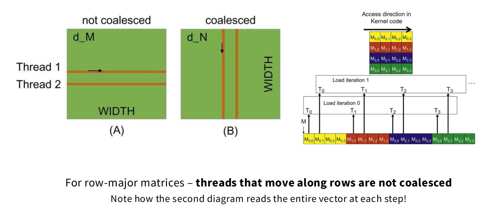

For instance, accessing a row-major matrix with threads distributed across different row indices produces fragmented, strided fetches; aligning threads across contiguous column elements along the same row index allows a single coalesced DRAM transaction to satisfy all threads simultaneously.

#### Tiling

Sharing the identical philosophy behind operator fusion, tiling aims to minimize redundant memory round-trips by maximizing arithmetic work per byte loaded into high-speed memory.

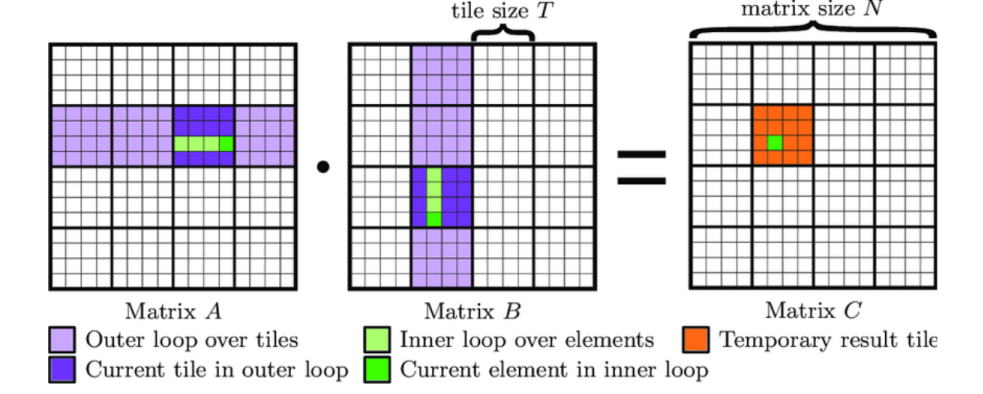

As depicted above, without tiling, every input element must be fetched from slow global memory \(N\) times; under a tiled scheme, global reads drop to \(N/T\) per element, supplemented by \(T\) subsequent reads from ultra-fast on-chip Shared Memory. Since shared memory operates at near-register speeds, this effectively reduces DRAM pressure by roughly \(\frac{1}{T}\) —an immense architectural win.

Crucially, the efficacy of tiling hinges dramatically on matrix geometries—poorly conditioned shapes incur catastrophic efficiency penalties. The first pitfall is bad tiling: edge tiles containing barely any real data end up spinning SM execution pipelines entirely in idle waste, as illustrated below.

)

The second pitfall is memory alignment: well-aligned dimensions allow tiled fetches to fully exploit DRAM concurrent burst transfers, whereas mismatched alignments trigger memory fragmentation that wrecks theoretical throughput.

" )

#### Performance Benchmark Teardown

" )

Armed with these principles, the bizarre cliffs and jagged steps in this benchmark plot suddenly make crystal-clear sense: the macro trend reflects arithmetic intensity scaling with matrix dimension; the abrupt performance cliffs highlight pathological shape misalignment (as broken down in the [Tiling]() section), where clean alignment alone can yield a nearly 2 x throughput boost; and finally, the mysterious periodic sawtooth dips stem from GPU wave quantization—when matrix dimensions cross specific boundaries, an extra wave is spawned with barely enough thread blocks to fill it, forcing SMs to run a nearly empty tail wave at full cost.

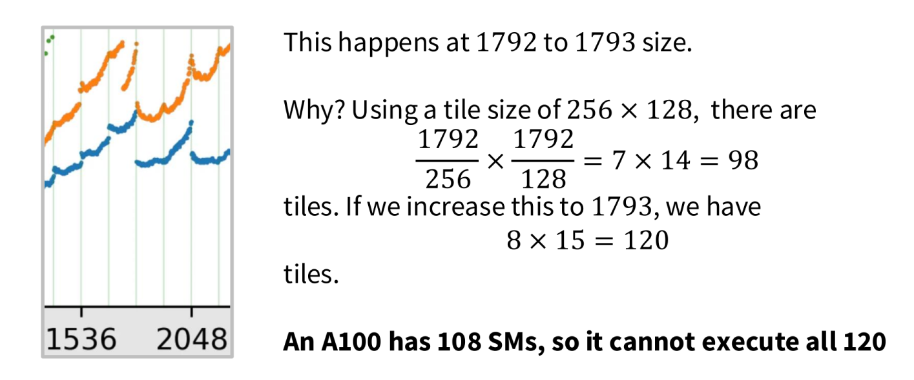

### Engineering Details

After soaking in the previous section, you might think systems engineering is just like architectural design—merely swapping in a different domain of knowledge. In practice, however, what we deal with here is far more granular and chaotic than you would expect. Consider this section an honest engineering rant 😅

#### Benchmarking

Before attempting any optimization, your very first prerequisite is building a benchmarking framework to quantify the system. In this context, a benchmarking framework essentially boils down to one goal: accurately measuring the wall-clock time of different compute phases.

Specifically, back in [Foundations](), we ended up with a neat Transformer model. As a first step, we can start with coarse-grained profiling: forward pass, backward pass, and parameter updates. These three major phases are straightforward to measure—just duplicate your training script, strip away extraneous logic, and place timestamps around each phase. You only need to watch out for two critical caveats:

1. Use `timeit.default_timer()` instead of `time.time()`, as the former hooks into the operating system's highest-resolution clock for tighter accuracy (modern deep learning hardware runs blazing fast, making sub-millisecond precision essential).
2. Call `torch.cuda.synchronize()` to flush any pending GPU execution. Kernel launches from the CPU are asynchronous; once a task is dispatched, the CPU moves on immediately, so you must explicitly block until the GPU finishes before taking the time delta.

Of course, such coarse timing is insufficient for low-level systems work. To pinpoint the exact execution time of specific kernels within a phase, you need NVIDIA's official profiling suite, [Nsight Systems](https://docs.nvidia.com/nsight-systems/index.html). PyTorch integrates with it natively via the `torch.cuda.nvtx` module. Using the API isn't hard, but the real engineering headache lies in instrumentation: injecting profiling markers cleanly. Ideally, profiling instrumentation should satisfy three requirements:

1. Simple, intuitive, and readable.
2. Ergonomic, with trivial toggles to enable or disable profiling at specific call sites.
3. Non-invasive, introducing zero pollution to the original training code.

In CS 336, the default approach is monkey patching. Specifically, you manipulate Python's module import system and intercept functions called by other modules, replacing them with annotated wrappers. It sounds reasonable enough, but in truth, it requires subtle handling—import ordering, how the target module initially imported the symbol, and so forth; one misstep and the patch fails silently. Moreover, monkey patching cannot profile the backward pass because PyTorch's autograd engine is encapsulated deep inside C++ internals where Python-level patches cannot reach.

```python
import cs336_basics.layers.multihead_self_attention as _mha # this should be a module type!

from cs336_systems.utils import annotated_scaled_dot_product_attention

# monkey patch
_mha.scaled_dot_product_attention = annotated_scaled_dot_product_attention  # type: ignore
```

This is where the gritty frustration of engineering truly shines. If you find monkey patching too hacky and set out to find a "more elegant" design pattern, congratulations: you will be hit with an Unlimited Void of esoteric abstractions. After weighing the options, you'll crawl back realizing that monkey patching is surprisingly the most pragmatic, straightforward, and "just right" tool for the job 😅

All in all, feeling lost when first dealing with these tools is completely normal. The best remedy for the chaos is continuous trial and error: run a command, inspect the profiler output (ask an AI when stuck), and recalibrate your mental model. You might ask: in this AI-driven era, do we still need to care about these low-level details? My take is: just remember the core intuition that leaves the deepest impression. For example, `nsys` maintains a chronological GPU event stream; NVTX markers merely project your CPU-defined time intervals onto that GPU timeline, showing you which kernels actually ran behind that block of code.

---

Here are some profiling results to look at. The table below lists the most time-consuming kernels when running various sequence lengths across different model sizes, with kernel names cleaned up to highlight their core semantics.

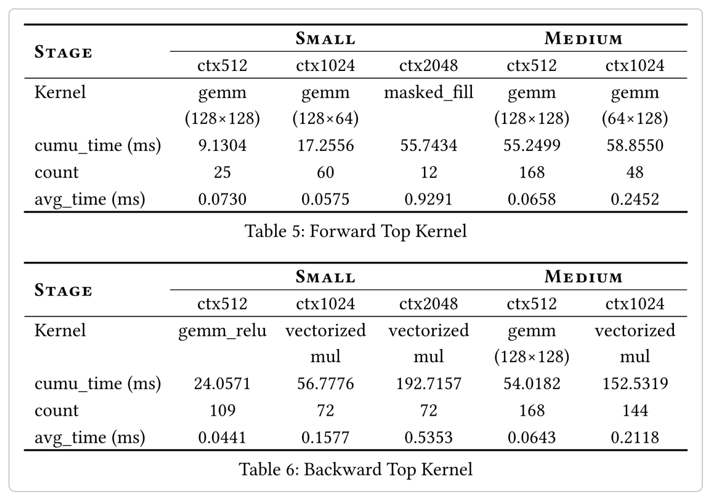

In the forward pass, the dominant time sink in most cases is the `gemm` kernel, i.e., general matrix multiplication (\(D = \alpha AB + \beta C\)). However, a noticeable inflection occurs once the context length reaches 2048: the top kernel flips to `masked_fill` (the attention masking step), illustrating that long-context regimes are bound by memory bandwidth rather than compute. During the backward pass, most time shifts to `vectorized_mul` (element-wise multiplication). This showcases a key characteristic of backpropagation: it involves a massive amount of element-wise operations (additions, element-wise exp, etc., all take notable shares) that carry significant memory overhead. Another detail worth noting is the tile shape of the `gemm` kernels—they do not match the exact shapes of our input tensors, which is simply GPU thread block tiling in action.

---

Regarding the warmup (cold start) issue: when benchmarking execution time, you generally need sufficient warmup runs and multiple measurements to take an average. When profiling memory, however, you don't need nearly as many runs—typically, a single warmup step and one measurement step are sufficient.

> [!warning] Pitfall
> You might wonder: *Since we're profiling memory, can't we just skip the warmup altogether? After all, memory reaches its peak during the very first backward pass anyway.* This assumption is actually quite subtle. In practice, you *could*, but you must understand what really happens under the hood. Due to how PyTorch operates, optimizer state memory is only allocated on the very first call to `optimizer.step()`. If your **profiling run consists of only one step**, the peak activation memory will have already passed and been freed *before* the optimizer state memory is allocated. As a result, what you measure isn't the steady-state peak memory, but merely \(\max(\text{activation peak}, \text{optimizer peak})\). What if your profiling run has two or more steps? Then you are essentially just shifting the warmup into your benchmark steps anyway. Therefore, **a warmup run is essential even when profiling memory!**

#### Triton Kernels

Before diving into it, Triton kernels might seem mysterious—like some dark magic that suddenly makes your models run blazingly fast. But in reality, once you gain some hands-on programming experience, you realize that the true magic lies in algorithm design rather than Triton kernels themselves, which is what we will cover in the next section on [FlashAttention](). Here, I mainly want to document a programming paradigm known as **Block Pointers**, which is a newer and much more intuitive approach.

Before grasping Block Pointers, there is a crucial mental model to understand. Inside a kernel, we are almost always dealing with a 2D computation, and it is always executed in tiles/blocks. This is because GPU SRAM (shared memory) is limited in size; you can only compute one tile, load the next, and repeat. You might ask: *what about higher-dimensional tensor computations?* There are generally two approaches: one is to flatten the dimensions and reshape/reconstruct them after computation; the other is to leverage Triton's grid syntax when launching the kernel. However, Triton grids only support up to 3 dimensions, meaning any extra dimensions must still be flattened before being passed into the kernel.

Here, the "grid" can be viewed as the parallel execution dimensions of the GPU. Each grid point (program instance / thread block) handles a designated portion of the work, and these instances should be **decoupled** from one another. Inside each instance, a loop sequentially loads and computes different tiles along the remaining dimension. For a simple 2D scenario, the grid could be aligned along either rows or columns. Once you pick a grid direction, imagine a row of lawnmowers lined up along that dimension, mowing block-by-block across the orthogonal dimension (yes, exactly like the lawnmowers in *Plants vs. Zombies* 😄).

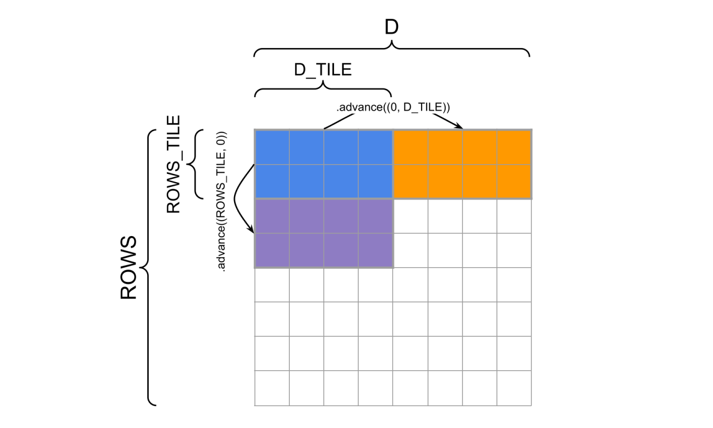

That sums up the core computational pattern of Triton kernel programming: it's actually quite clean and not drastically different from standard PyTorch, just with explicit tiling tricks added. What really drains your mental energy, however, is the data loading:

1. Logical tensor layouts and physical memory storage are decoupled; you have to advance and manipulate pointers with extreme care.
2. For computational efficiency, you must adjust the access pattern based on physical layout to exploit [Memory Coalescing]() for acceleration.
3. When the actual matrix dimensions cannot be evenly divided by the tile size, we typically round up (ceiling division) the grid to ensure all elements are covered. However, this introduces out-of-bounds memory accesses, requiring boundary padding.
4. When storing data back, out-of-bounds boundary checks are equally necessary.

Without the Block Pointer abstraction, handling these issues is tedious and error-prone. Code gets cluttered with edge cases, and the main computational logic ends up fragmented and unreadable. With Block Pointers, this complexity is neatly encapsulated inside the block declaration. Here are a few examples of Block Pointers:

```python
x_block_ptr = tl.make_block_ptr(
    x_ptr,
    shape=(NUM_ROWS, D),
    strides=(x_stride_row, x_stride_dim),
    offsets=(row_tile_idx * ROWS_TILE_SIZE, 0),  # parallel on rows, so only the affected set offsets
    block_shape=(ROWS_TILE_SIZE, D_TILE_SIZE),
    order=(1, 0),
)

weight_block_ptr = tl.make_block_ptr(
    weight_ptr,
    shape=(D,),
    strides=(weight_stride_dim,),
    offsets=(0,),
    block_shape=(D_TILE_SIZE,),
    order=(0,),
)

output_block_ptr = tl.make_block_ptr(
    output_ptr,
    shape=(NUM_ROWS,),
    strides=(output_stride_row,),
    offsets=(row_tile_idx * ROWS_TILE_SIZE,),  # row affected
    block_shape=(ROWS_TILE_SIZE,),
    order=(0,),
)
```

The first block pointer represents the parallelized dimension, requiring an explicit `offsets` parameter at initialization. The second block doesn't need an offset because all parallel threads start reading from the same base position. The third block is where the output is written back; since different threads write to distinct locations, it also requires an offset.  

The other two critical parameters to watch are `strides` and `order`: `strides` specifies the memory displacement (stride in elements/bytes) between logically adjacent elements along each dimension; `order` represents the dimension indices sorted by stride. Since PyTorch uses row-major ordering by default, the dimension with the smallest stride sits at the trailing index.  

Once all these configurations are declared, the core compute loop becomes remarkably concise:

```python
output = tl.zeros((ROWS_TILE_SIZE,), dtype=tl.float32)  # row allocator
for _ in range(tl.cdiv(D, D_TILE_SIZE)):
    row = tl.load(x_block_ptr, boundary_check=(0, 1), padding_option="zero")  # (ROW_TILE_SIZE, D_TILE_SIZE)
    weight = tl.load(weight_block_ptr, boundary_check=(0,), padding_option="zero")  # (D_TILE_SIZE)
    output += tl.sum(row * weight[None, :], axis=1)

    x_block_ptr = x_block_ptr.advance((0, D_TILE_SIZE))
    weight_block_ptr = weight_block_ptr.advance((D_TILE_SIZE,))

tl.store(output_block_ptr, output, boundary_check=(0,))
```

In plain English: load the tile data into SRAM while checking boundaries (padding with zeros if out of bounds), execute the compute, and accumulate the result into a local SRAM accumulator. Once the tile is processed, advance the pointer to the next tile. After all tiles are finished, flush the accumulated result from the local accumulator back into HBM (High Bandwidth Memory) all at once.

> [!NOTE]+ Note
> It might feel a bit disorienting the first time you try it, but it clicks once you get the intuition. That said, kernel programming remains undeniably tedious 😵, even with abstractions like Block Pointers. Moreover, once you complete this section, you will realize that writing kernels is not the end goal, but merely a tool; the real intellectual fun lies in figuring out how to decouple data dependencies so massive parallelism becomes possible.

#### FlashAttention

> A stroke of genius in algorithm design that decoupled data dependencies—and sent my brain spinning 😵‍💫😵.


Before writing the algorithm, we need to understand what's wrong with the current implementation, and doing so requires a prerequisite: matrix calculus. I highly recommend checking out these two Zhihu articles: *Matrix Calculus Techniques (Part 1)* and *Matrix Calculus Techniques (Part 2)*. They are wonderfully lucid reads that fill the gaps left by standard college calculus without requiring you to slog through massive matrix analysis textbooks.

I won't dive into the full mathematical derivation here, so I'll just include two algorithm pseudocode screenshots:

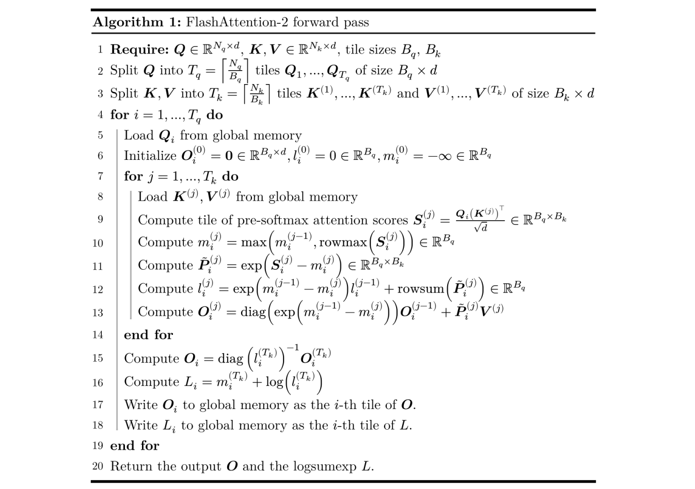

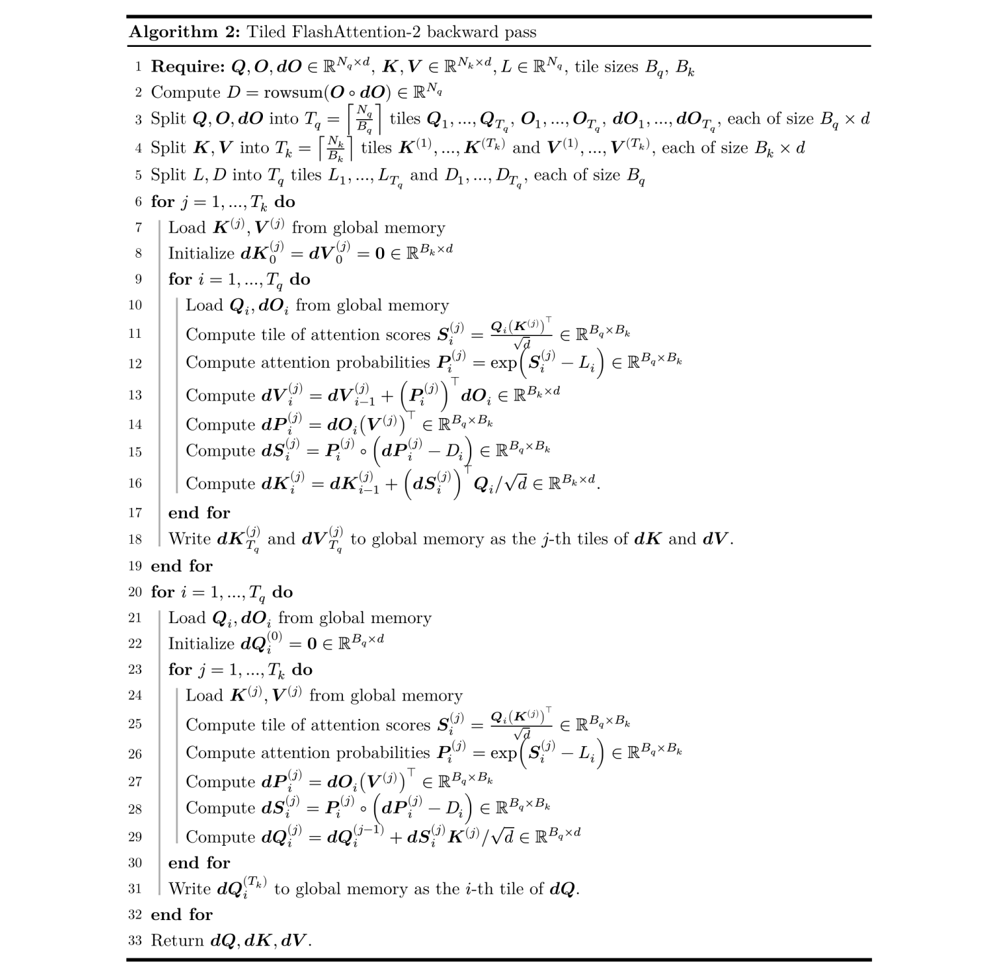

The impact of FlashAttention goes without saying: it achieves an attention algorithm with \(O(N)\) memory access, drastically slashing total execution latency. However, what deserves the most attention is the "online softmax" algorithm in the forward pass. How should we intuitively understand why this works?

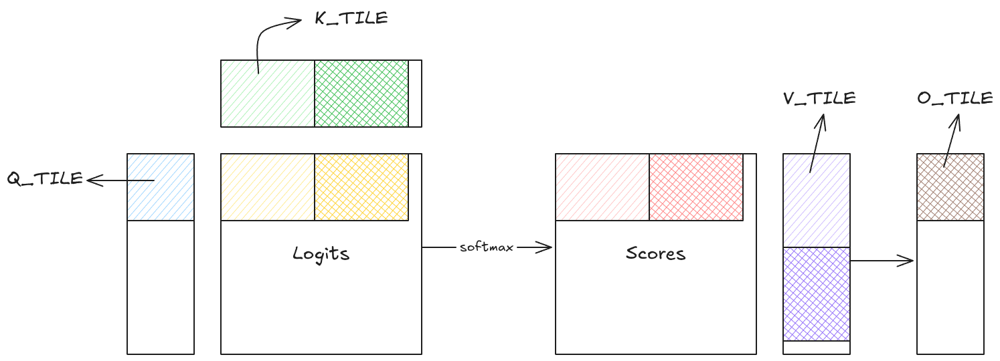

The core idea of online softmax is to update/rescale prior partial results using newly observed incoming data. A common point of confusion is: *once I have already finished computing a tile, how can I retroactively update previous outputs?*  

In fact, the intermediate attention scores themselves cannot be modified once discarded. But remember: we don't actually need to store the attention scores—what we ultimately care about is the output matrix \(O\). As shown in the figure, the matrix multiplication between the attention scores and \(V\) acts as an accumulator, allowing computations across different \(K\) (and \(V\)) tiles to contribute incrementally to the same output tile \(O\). In my view, this is the very prerequisite that makes online computation feasible in the first place.

> [!NOTE] Remark
> Because of this, I feel that calling this mechanism "online softmax" isn't entirely accurate; it might be better termed "online tiled attention." Pure softmax on its own cannot be computed in a streaming online fashion like this—or rather, in standalone softmax, later tiles have no way to retroactively correct the outputs of preceding tiles without keeping everything around. 🤔

### Distributed Training

Why do we need distributed training in the first place? There are two primary scenarios: First, suppose you have an entire compute cluster—you need to squeeze every drop of performance out of these accelerators to avoid wasting compute. Second, you have a massive model that cannot fit on a single GPU, a single rack, or even a modest cluster. At that point, distributed training is no longer optional—it is a necessity.


As shown in the figure, this is a common interconnection topology for GPU clusters. While TPU clusters often adopt different network designs (typically toroidal mesh topologies), tree-like hierarchical network topologies have become increasingly dominant as MoE (Mixture of Experts) has become the de facto standard.

> [!NOTE]- Note
> Why not connect every GPU point-to-point (all-to-all)? While that minimizes communication latency and maximizes bandwidth, the cost is prohibitive: the required cabling scales quadratically (\(O(N^2)\)) with the number of GPUs. Furthermore, it is extremely inflexible, as adding a single new GPU would require rewiring connections to every existing device.

#### Collective Operations

Before exploring complex parallelization strategies, let's first establish the foundational collective communication primitives shown below:

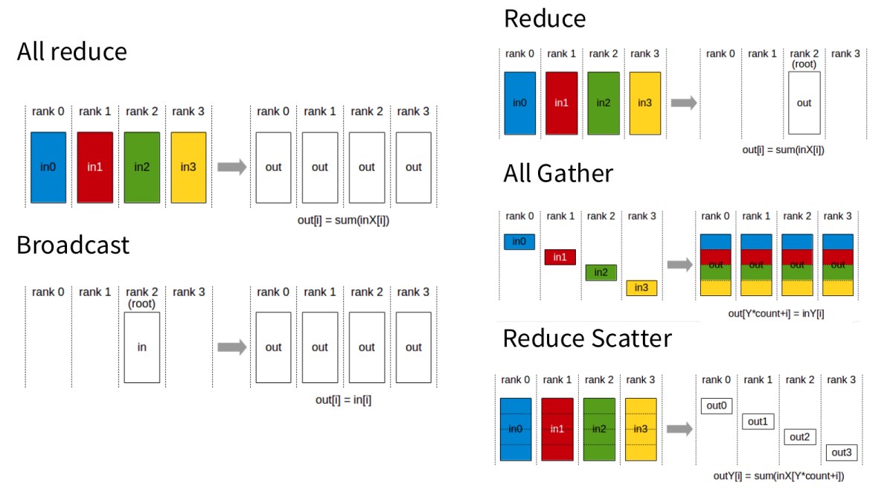

Among these, `All-Reduce` deserves special attention. Implemented naively, its communication overhead is enormous. For example, if every rank simply broadcasts all its data to every other rank and computes the reduction locally, the total transfer volume scales as \(3 \times 4 = 12\). A vastly more efficient approach decomposes `All-Reduce` into a `Reduce-Scatter` followed by an `All-Gather`, slashing the total communication volume down to \(4 \times \left(\frac{3}{4} + \frac{3}{4}\right) = 6\).

> [!NOTE]+ Sidenote
> Splitting a large collective operation into smaller stages offers another key advantage: it allows communication to overlap with computation, further reducing the effective communication bottleneck.

#### Data Parallelism (DP)

Vanilla Data Parallelism is straightforward: you slice the batch across the batch dimension and assign a sub-batch to each GPU. The forward pass proceeds identically on each device, and during the backward pass, an `All-Reduce` synchronizes the gradients across all GPUs. The glaring drawback, however, is that every single GPU must maintain an entire replica of the model weights, gradients, and optimizer states.

ZeRO (Zero Redundancy Optimizer) introduced an exceptionally elegant solution that breaks this down into three progressive stages, as illustrated below. ZeRO is widely celebrated as "elegant" because it eliminates memory redundancy almost for free, adding negligible communication overhead compared to standard DP.

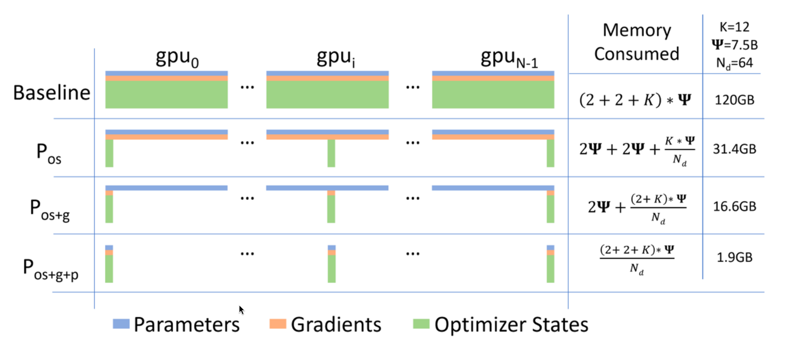

**Stage 1: Optimizer State Partitioning.** Different GPUs store and update optimizer states for different parameter slices. This is implemented via `Reduce-Scatter` + `All-Gather`: each GPU computes full gradients on its local batch, scatters them to the corresponding owning GPU to perform the optimizer step, and then gathers the updated parameters back. This introduces virtually zero extra communication cost over standard `All-Reduce`, yet eliminates the vast majority of redundant optimizer memory.

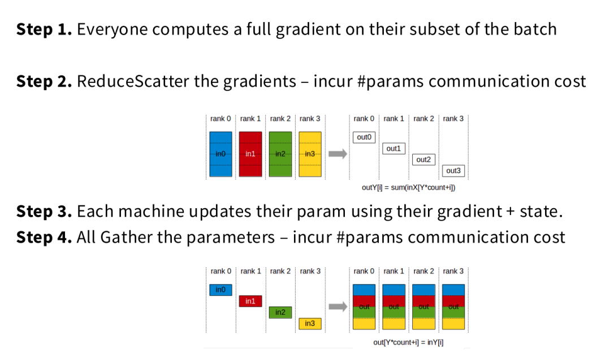

**Stage 2: Gradient Partitioning.** Unlike Stage 1—which traverses the entire backward graph before synchronizing all gradients at once—Stage 2 exchanges gradients layer-by-layer during the backward pass itself, immediately freeing any gradients that the local device does not own. This is conceptually straightforward, costs no extra communication, and partitions the gradient memory footprint evenly across devices.

**Stage 3: Parameter (Weight) Partitioning.** Here, even the model weights are sharded across GPUs. Each GPU holds only a fraction of the parameters. Whenever a forward or backward computation requires weights stored on another device, they are fetched on the fly via collective communication and immediately discarded after use. Remarkably, this can still be achieved with minimal communication penalty by overlapping parameter fetching with the preceding layer's computation. For compute-heavy workloads (such as large matrix multiplications) running over high-bandwidth interconnects, this pipelining effectively hides the communication overhead.

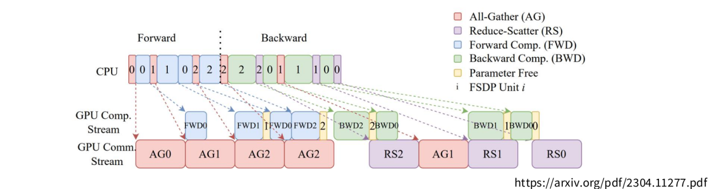

However, ZeRO is not a silver bullet. It has an implicit constraint: the number of GPUs cannot exceed the batch size. You might think, "No problem, just crank up the batch size." But while GPU counts can scale, effective batch size cannot grow indefinitely. Beyond a certain threshold (critical batch size), training efficiency saturates; scaling the batch size further causes GPUs to idle on sub-optimal optimization dynamics, resulting in wasted compute.

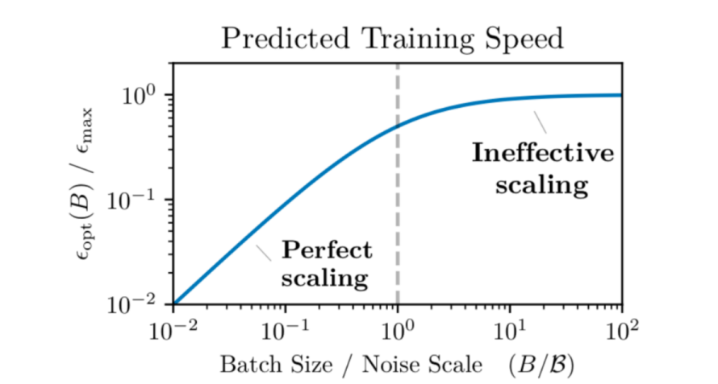

Another limitation of ZeRO is that it does not partition activation memory. Consequently, while Stage 3 makes it look effortless to scale model size on paper, activations quickly become the true memory bottleneck. To rein in activation memory, one must turn to model parallelization during the forward pass.

#### Pipeline Parallelism (PP)

Pipeline parallelism is both intuitive and somewhat counter-intuitive—it is arguably the least "parallel-feeling" of all parallel paradigms. Conceptually, different layers of a model are assigned to different GPUs sequentially; once GPU \(N\) finishes computing its stage, it passes the intermediate activations downstream to GPU \(N+1\). You can immediately spot the problem: catastrophic pipeline stalls ("bubbles"). A common fix is to break each batch into multiple micro-batches, as illustrated below.

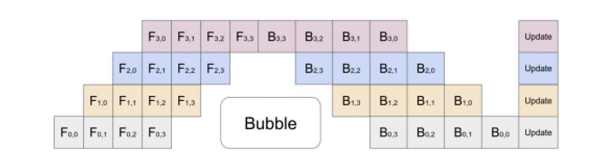

Naturally, keeping a pipeline fully utilized requires a sufficiently large batch size, and throughput is notoriously sensitive to this value. To mitigate this idle time, complex pipeline scheduling schemes have been developed to squeeze out as many bubbles as possible. This begs the question: can we eliminate the pipeline bubble entirely? The answer is yes.

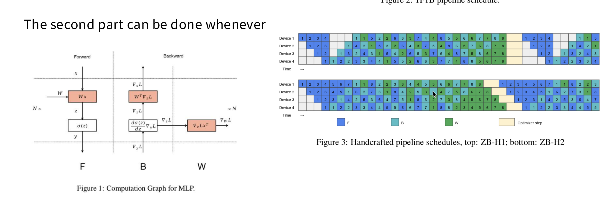

A closer look at backpropagation reveals that it consists of two decoupled computations: computing the gradient with respect to the input activation (\(x\)) and computing the gradient with respect to the weights (\(W\)). The input gradient \(\nabla_x\) is time-critical because it must be passed backward to earlier pipeline stages immediately. In contrast, the weight gradient \(\nabla_W\) only needs to be finished before the optimizer step; its execution can be rescheduled arbitrarily to fill the idle pipeline bubbles. With a properly designed schedule, bubbles can be almost completely eliminated!

#### Tensor Parallelism (TP)

Tensor Parallelism operates at a finer granularity, as illustrated below. For an MLP block, we can slice matrix \(A\) along columns and matrix \(B\) along rows. This minimizes intermediate synchronization, because the inner dimension matches the matrix multiplication requirements naturally. One subtle detail: during backpropagation, the communication functions \(f\) and \(g\) must swap roles to preserve computational graph consistency.

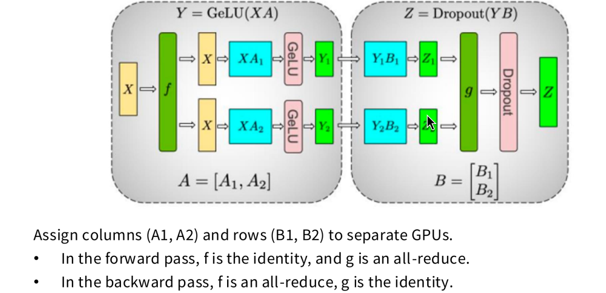

What is the catch with Tensor Parallelism? Because it operates at the sub-layer/operator level, communication collectives are invoked hundreds of times per training step. These operations are strictly synchronous, leaving virtually no room to hide communication behind computation. Moreover, TP exhibits a poor compute-to-communication ratio that cannot be amortized by scaling batch size. Here, \(tp\) represents the tensor parallel degree:


$$
\text{Ratio} = \frac{\frac{16 \cdot b \cdot s \cdot h^2}{tp}}{4 \cdot b \cdot s \cdot h} = \frac{4h}{tp}
$$

In short, Tensor Parallelism is intensely communication-bandwidth hungry. In practice, it is almost exclusively confined within high-speed local interconnect domains, such as NVLink/NVSwitch within a single physical node.

#### Sequence Parallelism and Context Parallelism

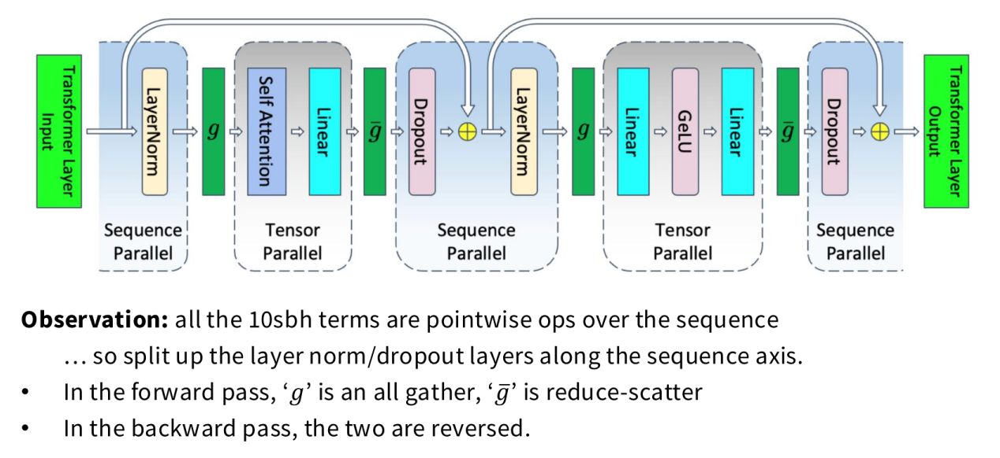

Sequence Parallelism (SP) is typically applied to residual connections and LayerNorm/RMSNorm modules. In naive Tensor Parallelism, every GPU keeps a fully replicated copy of the activations in these non-TP regions. SP addresses this by splitting activations along the sequence length dimension, directly curbing activation memory.

Context Parallelism (CP) pushes this idea further into the attention mechanism itself by partitioning the Key-Value (KV) cache across devices. Techniques like RingAttention operate similarly to `All-Reduce` at the communication layer, passing token chunks in a ring topology to compute attention progressively.

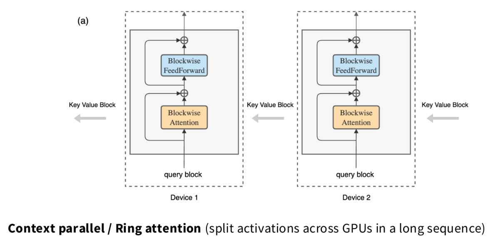

By layering these model-level parallel strategies on top of one another—complemented by selective activation checkpointing—virtually every component of activation memory can be sharded evenly across GPUs.

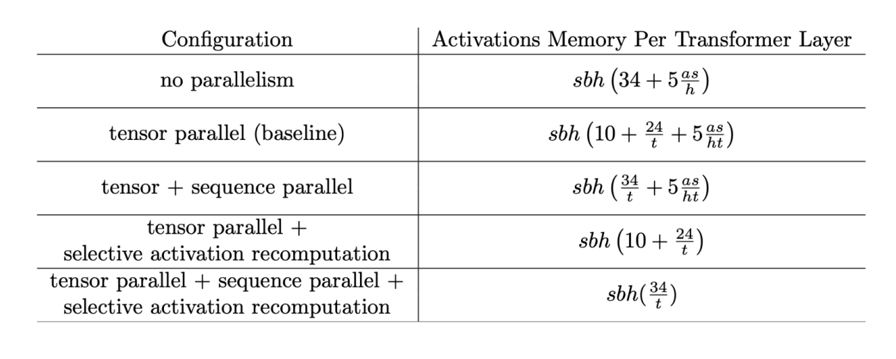

> [!NOTE]- 😂
> What an absolute masterclass in squeezing hardware dry! 🤣

#### Expert Parallelism (EP)

The term "Expert Parallelism" can sound slightly redundant at first glance, since Mixture-of-Experts (MoE) is inherently parallel: different experts reside on different GPUs, and intermediate tokens are dynamically routed to their target expert devices. That is indeed how it works in practice.

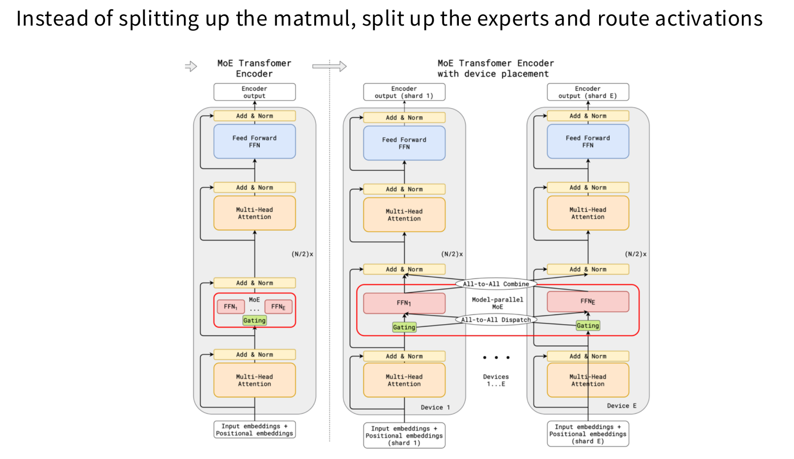

The real engineering complexity of Expert Parallelism arises when composing it with other parallelism paradigms. Notably, Data Parallelism and Expert Parallelism can share parameter sharding under the hood, meaning the degree of Expert Parallelism generally should not exceed the degree of Data Parallelism.

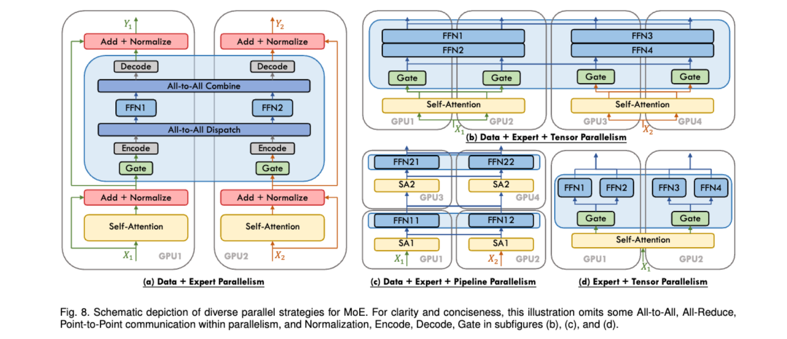

> [!warning]+ Warning
> You cannot blindly scale Data Parallelism and Tensor Parallelism to arbitrary extremes in an MoE setup. GPUs are fundamentally designed for large matrix multiplications; keeping arithmetic workloads sufficiently dense is essential to reaching theoretical peak compute throughput.

#### Hybrid Parallelism

With so many specialized parallelization dimensions available, how do we stitch them together in real-world systems to achieve peak performance?

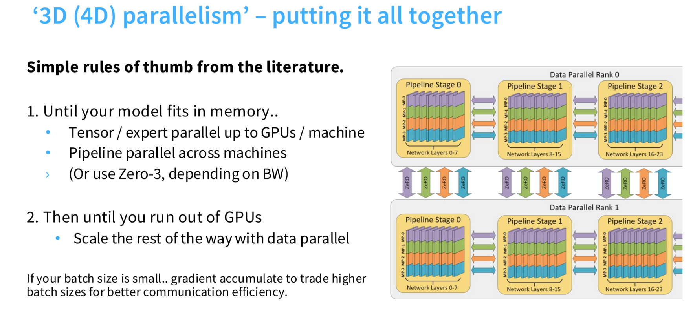

In modern large-scale training, the standard recipe is 3D (or 4D) Parallelism:

1. **Intra-node:** Each yellow box represents an NVLink domain, within which we execute model-level intra-layer parallelisms (Tensor Parallelism, Sequence Parallelism, Context Parallelism, and Expert Parallelism).
2. **Inter-stage:** Different yellow boxes represent distinct model layers, chained together via Pipeline Parallelism.
3. **Cluster-wide:** Finally, the 2D/3D units formed above are replicated across the remaining nodes using Data Parallelism (ZeRO).

As a rule of thumb, you first use Model Parallelism and Pipeline Parallelism to fit the model within hardware memory limits (tuning tensor shapes so they are just large enough to maximize GPU matrix computation efficiency). Once memory constraints are cleared, you scale Data Parallelism across the cluster to saturate the remaining compute capacity.

### Inference

It is well known that training LLMs consumes massive amounts of compute. However, across the entire lifecycle of a model, inference often accounts for an even larger share of total compute. Moreover, inference performance is directly tied to user experience, making systematic engineering optimizations absolutely crucial. Because GPU workloads during inference differ fundamentally from those during training, they require dedicated analysis.

Naturally, we want our inference system to be as fast as possible, but "fast" can mean several different things:

1. **Time-to-First-Token (TTFT)**: Measures the blank waiting time experienced by the user, typically in milliseconds (ms).
2. **Token Latency / Inter-Token Latency (ITL)**: The time cost required to produce each subsequent token for a user request, typically measured in seconds per token (s/token) or milliseconds.
3. **Throughput**: Measures the overall capacity of the system, defined as the total number of tokens generated per second across all users, in tokens/s (or \(\text{s}^{-1}\)).

> [!NOTE] Note
> While "token rate" is sometimes used colloquially, the standard English technical term is per-token *latency* (or Inter-Token Latency). Because using "latency" for both TTFT and individual token generation can be slightly ambiguous in Chinese, we often refer to it as "token rate" or "per-token generation time."

#### Inference Workflow

Below is the standard Transformer architecture flowchart along with the tensor shapes involved in the computation (see [Model Architecture]() for full details). To keep subsequent calculations clean, we assume the canonical parameter relations: \(F = 4D\), \(D = NH\), and \(N = KG\). We also default to `bfloat16` precision throughout.

" )

> [!NOTE] Note
> Seeing both \(S\) and \(T\) at first glance might be confusing—why are there two sequence lengths? Think of \(S\) as the length of the prior context tokens (hence labeled alongside KV in the diagram), while \(T\) represents the sequence length generated in a single forward pass. Naively, \(T=1\); however, techniques like speculative decoding (discussed in [Lossless Speedup]()) can produce multiple tokens in a single step (\(T > 1\)). Additionally, this diagram adopts Grouped-Query Attention (GQA), discussed in [Lossy Speedup]().

The most naive inference implementation looks like the figure below, where every step mirrors standard training: we compute the next-token prediction distributions across all sequence positions, extract the prediction distribution of the very last token, sample a new token using some decoding strategy (temperature scaling, top-\(p\) truncation, etc.), concatenate it back to the input sequence, and repeat. As you can imagine, this approach incurs an \(O(n^2)\) computational complexity in feed-forward layers and \(O(n^3)\) in attention layers, introducing staggering amounts of redundant computation.

" )

The de facto industry standard to eliminate this redundancy is **KV Caching**. With a KV cache in place, inference splits into two distinct phases:

1. **Prefill Phase**: Similar to training, the model processes an extended prompt of known tokens in parallel to produce the initial logits, while simultaneously caching the computed \(K\) and \(V\) tensors across layers for subsequent attention calculations.
2. **Decode Phase**: Generates one token at a time sequentially, computing and appending only the newly generated token's \(K\) and \(V\) tensors to the cache.

" )

#### Arithmetic Intensity Analysis

Let us look at the data flow of a standard SwiGLU-style Feed-Forward Network (FFN): Load the attention output \(X \in \mathbb{R}^{B \times T \times D}\), the up-projection weights \(W_u \in \mathbb{R}^{D \times F}\), the gate weights \(W_g \in \mathbb{R}^{D \times F}\), and the down-projection weights \(W_d \in \mathbb{R}^{F \times D}\). Compute \(X W_u\) to get \(U\) and write it to HBM; compute \(X W_g\) to get \(G\) and write it to HBM; read back both results, apply element-wise GeLU/SiLU activation to \(G\), compute the element-wise product \(U \odot \text{act}(G)\), multiply by \(W_d\), and write the final output back to HBM.

Accounting for total data movement (\(20BTD + 24D^2\ \text{Bytes}\)) and floating-point operations (\(24BTD^2\ \text{FLOPs}\)), the arithmetic intensity of the FFN layer evaluates to:


$$
I = \frac{24BTD^2}{20BTD + 24D^2} = \frac{6BTD}{5BT + 6D}\quad \text{FLOPs/Byte}
$$

During the **prefill phase**, both the batch size \(B\) and sequence length \(T\) are relatively large. Here, arithmetic intensity approaches \(1.2D\), almost effortlessly saturating the theoretical compute capacity of the GPU. Even under moderate batch sizes and sequence lengths, hitting the compute-bound regime remains easily achievable with minimal mathematical margin.

> [!NOTE]+ H 100 Reference Specifications
> An NVIDIA H 100 SXM boasts roughly \(9.89 \times 10^{14}\) FLOPs/s of peak dense FP 16/BF 16 compute and \(3.35 \times 10^{12}\) Bytes/s of HBM 3 memory bandwidth, yielding a hardware ridge point (roofline turning point) of approximately 295 FLOPs/Byte. To fully utilize the compute cores, our arithmetic intensity needs to exceed this threshold.

During the **decode phase**, assuming we generate a single token per step (\(T = 1\)), the FFN faces a noticeable bottleneck: \(B\) depends on concurrent user requests, which is an external operational variable rather than something fixed by model engineering. When concurrency is low, arithmetic intensity drops drastically. However, for mainstream production workloads serving high concurrency, we can batch requests together to achieve a sufficiently high \(B\), effectively driving the GPU back toward compute saturation (see [Dynamic Workloads]()).

---

Next, let us analyze the Attention layer (assuming FlashAttention without GQA for now). The flow is as follows: Read input \(X \in \mathbb{R}^{B \times T \times D}\) and projection matrices \(W_Q, W_K, W_V \in \mathbb{R}^{D \times D}\). Perform matrix multiplications to obtain \(Q, K, V \in \mathbb{R}^{B \times T \times N \times H}\). The newly computed \(K\) and \(V\) are written to the KV cache in HBM, while \(Q\) stays in on-chip SRAM. \(Q\) is multiplied by the cached keys \(K_{\text{all}}^T \in \mathbb{R}^{B \times S \times N \times H}\), scaled, masked, softmaxed, and multiplied by \(V_{\text{all}}\). Thanks to FlashAttention, these intermediate attention matrices are fused in SRAM without intermediate roundtrips to HBM. Finally, the attention output \(O \in \mathbb{R}^{B \times T \times N \times H}\) is written back.

Summing all data movement (\(8BTD + 6D^2 + 4BSD\ \text{Bytes}\)) and compute (\(6BTD^2 + 4BTSD\ \text{FLOPs}\)), the arithmetic intensity for the Attention layer is:


$$
I = \frac{3 \frac{D}{S} + 2}{\frac{4}{S} + 3 \frac{D}{BTS} + \frac{2}{T}}
$$

In the **prefill phase**, where \(T = S\) and \(B\) are substantial (often matching or exceeding \(D\)), achieving the target arithmetic intensity is straightforward, even under dynamic batch variations.

In the **decode phase**, however, \(T = 1\). Even if the context length \(S\) grows very large, the asymptotic arithmetic intensity tops out around \(1\ \text{FLOP/Byte}\). This is disastrously low compared to hardware capabilities.

This theoretical analysis brings us to a stark conclusion: **the Attention layer during decode is severely memory-bandwidth bound. Simply tweaking hyperparameters will not fix this; it demands architectural and algorithmic innovations.**

#### Performance Metric Analysis

Having established that decoding is predominantly memory-bound, we can reasonably ignore raw computation when estimating token latency and throughput to obtain clean, insightful closed-form estimates. Furthermore, production inference engines employ aggressive operator fusion to eliminate unnecessary data roundtrips, meaning minor memory accesses can be ignored (accounting for only fractions of a percent). Our analysis boils down to two dominant memory transfers: **model weights** and **KV Cache**.

The total model parameter count (without GQA, where \(K = N\)) is approximated by:


$$
\text{Param} = \underbrace{2VD}_{\text{Embedding \& LM Head}} + \underbrace{3DFL}_{\text{MLP}} + \underbrace{\Big( \underbrace{DNH}_{W_Q} + \underbrace{2DKH}_{W_{K,V}} + \underbrace{DNH}_{W_O} \Big) L}_{\text{Attention}}
$$

The memory footprint of the KV Cache is given by:


$$
\text{Memory}_{\text{KV}} = \underbrace{2}_{\text{Key \& Value}} \cdot \underbrace{P}_{\text{Bytes/Elem}} \cdot \underbrace{BS}_{\text{Tokens}} \cdot \underbrace{L}_{\text{Layers}} \cdot \underbrace{KH}_{\text{KV Dim}}
$$

In the memory-bound regime, theoretical per-token generation latency is simply the time required to stream all weights and cache entries through memory:


$$
\text{Latency} = \frac{\text{Param} + \text{Memory}_{\text{KV}}}{\text{Mem\_bandwidth}}
$$

From a system batching perspective, the aggregate throughput is:


$$
\text{Throughput} = \frac{B}{\text{Latency}} = \frac{B \cdot \text{Mem\_bandwidth}}{\text{Param} + \text{Memory}_{\text{KV}}}
$$

Plugging in concrete parameters for **Llama-2-13 B** yields the following estimates:

Batch Size | `num_params` | `memory` (Bytes) | `latency` (s) | `throughput` (tokens/s)
:----- | :----- | :----- | :----- | :-----
**b 1** (\(B=1\)) | 13,015,449,600 | 26,869,760,000 | 0.0080 | 124.68
**b 64** (\(B=64\)) | 13,015,449,600 | 79,717,990,400 | 0.0238 | 2689.48
**b 256** (\(B=256\)) | 13,015,449,600 | 240,779,264,000 | 0.0719 | 3561.77

Notice the fundamental trade-off: **per-token latency and aggregate throughput are inherently at odds**. Scaling \(B\) improves GPU utilization and boosts overall system throughput, but each individual user experiences higher latency per token. System engineering is fundamentally about striking the right balance between the two.

We have not modeled TTFT in detail here, but conceptually it is the sum of the prefill processing time and the first decode step. Because both scale with \(B\) and prompt length, increasing \(B\) will likewise increase TTFT.

#### Lossy Speedup

To accelerate inference, optimization strategies target the two largest memory contributors: the **KV Cache** and the **model weights**.

To compress the KV Cache, a direct approach is to decouple the number of KV heads from query heads (**Grouped-Query Attention, GQA**). For example, while standard multi-head attention might use 8 query heads of dimension 128 and 8 matching KV heads, GQA uses only 4 KV heads (each shared across 2 query heads), instantly halving the KV cache footprint. Empirical findings demonstrate that as long as the architecture does not collapse all the way to a single KV head (Multi-Query Attention), performance degradation is negligible.

" )

DeepSeek demonstrated exceptional system-level engineering with **Multi-Head Latent Attention (MLA)**. Instead of caching full per-head KV tensors, MLA projects the KV representations into a low-dimensional latent space before caching. At decode time, queries absorb the decompression matrices directly via linear re-association before interacting with the cached latent vectors. This grants fine-grained control over the compression ratio far beyond standard GQA. Remarkably, the added representational flexibility actually *boosted* downstream benchmark performance—a true architectural win-win.

" )

Other KV compression paradigms include cross-layer attention sharing, sliding window attention, and various linear attention mechanisms, which we omit here for brevity.

---

On the model weight side, two primary techniques dominate: **Quantization** and **Pruning / Distillation**.

Quantization represents high-precision numerical values using lower-precision formats. Intuitively, imagine a sparse grid in continuous space; quantization snaps scattered high-precision values onto these discrete grid points. It is typically categorized into:

1. **Quantization-Aware Training (QAT)**: Simulates quantization rounding errors during training. The downside is steep training overhead, slower convergence, and degraded stability, demanding significantly more data and compute hours.
2. **Post-Training Quantization (PTQ)**: Calibrates quantization scales on a small validation set after full training is complete. It is computationally cheap and preserves most of the original model performance ([Frantar et al., 2022](https://arxiv.org/abs/2210.17323)).
3. **Activation/Attention Quantization**: Dynamically retains higher precision for high-magnitude outlier values while quantizing the rest, as activation outliers interact multiplicatively with subsequent weights ([Lin et al., 2023](https://arxiv.org/abs/2306.00978)).

In model pruning and distillation, representative works include NVIDIA's Nemotron-4-15 B and Minitron-8 B ([Muralidharan et al., 2024](https://arxiv.org/abs/2407.14679)).

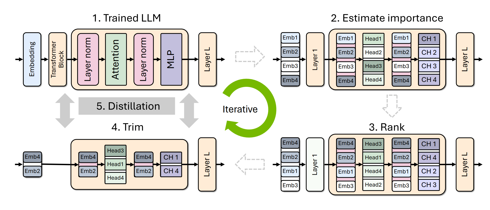

The results are striking: the pruned and distilled Minitron-8 B achieved superior benchmark performance at a fraction of the training cost compared to Nemotron-3-8 B trained from scratch.

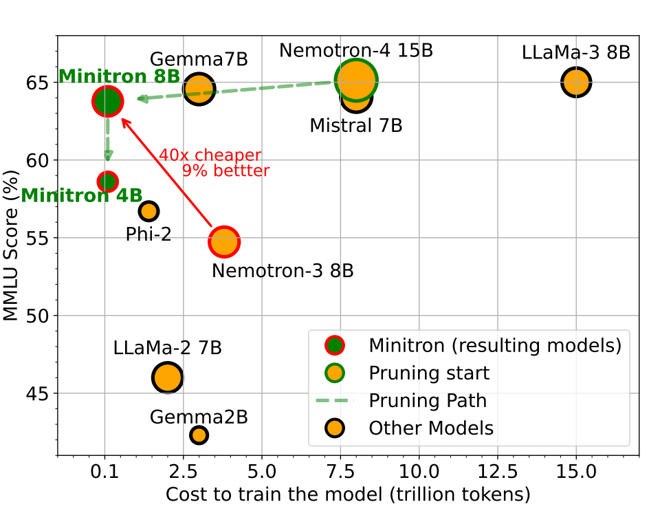

#### Lossless Speedup

The methods above modify or compress either the KV cache or the model parameters. While modern methods minimize quality loss (or even improve it, as with MLA), is it possible to achieve true **lossless** acceleration? Currently, the primary answer is **Speculative Decoding**.

Speculative decoding leverages the observation that running a forward verification pass over multiple candidate tokens in parallel (prefill-like compute) is far cheaper than generating those tokens sequentially one by one. Verifying tokens is compute-bound and fast; generating them sequentially is memory-bound and slow. It operates on a low-penalty, high-reward principle reminiscent of branch prediction in modern CPU pipelines.

Specifically, a small, fast draft model rapidly proposes a sequence of \(K\) candidate tokens. The target base model then evaluates these candidates in a single parallel forward pass. In practice, a prefix of the candidates is accepted (e.g., verifying 4 speculative tokens might confirm 2). The target model then samples a corrected token right at the first rejected position using its own output distribution, and the draft model continues speculating from there. A clear [visual demo](https://storage.googleapis.com/gweb-research2023-media/media/SpeculativeDecoding-1-Illustration.mp4) illustrates this cycle nicely.

> [!NOTE] Note
> The algorithm uses modified rejection sampling guarantees: the accepted tokens mathematically follow the exact output distribution of the target model, making the acceleration provably lossless.

An interesting question arises: how closely must the draft model's probability distribution align with the target model to yield a net speedup? A loose mathematical bound reveals that the distribution overlap \(\alpha\) between the two models must exceed the execution speed ratio \(c\) of the draft model relative to the target model:


$$
\alpha = \mathbb{E}_{x \sim Q} \left[ \min\left(1, \frac{P(x)}{Q(x)}\right) \right] = \sum_{x \in \mathcal{V}} Q(x) \min\left(1, \frac{P(x)}{Q(x)}\right) = \sum_{x \in \mathcal{V}} \min(P(x), Q(x))
$$

where \(P(x)\) is the target model's distribution, \(Q(x)\) is the draft model's distribution, and \(\mathcal{V}\) is the vocabulary. In practice, this theoretical bound is fairly optimistic: when \(c \approx 0.1\), the draft model generally needs a top-1 token agreement rate exceeding \(65\%\) against the target model on standard benchmarks to deliver roughly a \(2\times\) wall-clock speedup.

#### Dynamic Workloads

From a systems perspective, our primary lever for maximizing throughput is scaling the batch size \(B\). However, real-world inference workloads are inherently dynamic: user requests arrive asynchronously with wildly varying prompt and generation lengths. Orca introduced an elegant solution: **iteration-level scheduling** (continuous batching). Instead of scheduling at the granularity of entire requests, scheduling happens at the granularity of individual forward passes. The moment a request outputs an end-of-sequence token, it exits the batch, and a pending request immediately steps in to take its slot.

" )

A practical challenge is that standard dense tensor operations expect uniform rectangular tensors. How do we handle batches composed of jagged, non-uniform sequences? Orca observed that outside the Attention layers, Transformer operations (FFNs, norms, embeddings) treat tokens independently; tokens across different requests can simply be flattened into a single contiguous token dimension. Attention operations, which depend on sequence boundaries, are handled via ragged attention kernels.

---

Taking memory management a step further, the vLLM paper addressed memory fragmentation within and across requests, unlocking substantially larger batch sizes on the same hardware. As illustrated below, memory waste comes in two flavors: *internal fragmentation*, caused by over-allocating fixed memory buffers for maximum possible sequence lengths that users rarely exhaust; and *external fragmentation*, arising from dynamic memory allocation and deallocation across asynchronous requests of varying lengths.

" )

Borrowing directly from classical OS virtual memory concepts, **PagedAttention** partitions each sequence's KV cache into fixed-size blocks allocated across non-contiguous physical GPU memory. This raises effective memory utilization from around \(40\%\) to over \(96\%\). A major side benefit is zero-copy memory sharing: requests sharing common prefixes (such as shared system prompts or tree branches in parallel sampling) can share physical KV blocks, cutting memory consumption even further and driving up overall system throughput.

" )

## Scaling Laws

In popular discourse, "scaling law" is often treated as a blunt assertion: scale up the model, feed it more data, and performance will keep climbing. In reality, that is merely a description of the *scaling effect*. A genuine *scaling law* provides actionable, quantitative foresight: it allows us to extrapolate the outcomes of massive, expensive training runs directly from controlled, small-scale experiments.

Imagine you are the chief infrastructure engineer at a company with a 10,000-GPU cluster. Management asks you to deliver a state-of-the-art foundation model within a month. How do you design the model architecture? How do you partition GPU hours across pretraining stages? Most critically: how do you justify your technical roadmap with quantitative guarantees? You cannot simply tell leadership, "We made the run bigger, so trust me, the model will be better." Large-scale runs cost millions of dollars; quantitative predictability is precisely what scaling laws provide.

### Data Scaling Laws

Empirical observation across thousands of runs shows that test loss exhibits a consistent power-law relationship with dataset size: \(\text{loss} = c n^{-\alpha}\). Why power laws? A simple, intuitive (though non-rigorous) mental model is estimating the mean of a 1D Gaussian distribution from \(n\) samples, \(x_1, x_2, \dots, x_n \sim \mathcal{N}(\mu, \sigma^2)\). The optimal estimator is the sample average:


$$
\hat{\mu} = \frac{\sum_{i=1}^{n} x_i}{n}
$$

The expected estimation error is:


$$
\mathbb{E}[(\hat{\mu} - \mu)^2] = \frac{\sigma^2}{n}
$$

Taking the logarithm on both sides:


$$
\log(\mathbb{E}[(\hat{\mu} - \mu)^2]) = -\log n + 2 \log \sigma
$$

This produces a clean linear relationship on a log-log plot. If we view complex learning tasks as superpositions of many such sub-tasks, the overall error trajectory naturally tracks a straight line in log-log space.

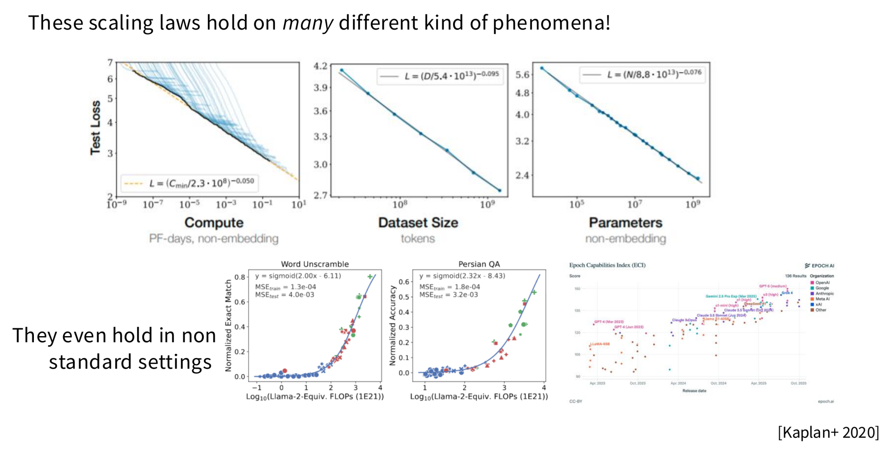

While the power-law form is clear, what determines its slope? In our simple Gaussian example, the scaling exponent is \(-1\). Do real-world learning tasks scale with an exponent of \(-1\)? Empirically, exponents vary dramatically across different data modalities and tasks, and observed slopes are consistently shallower than simple theory predicts.

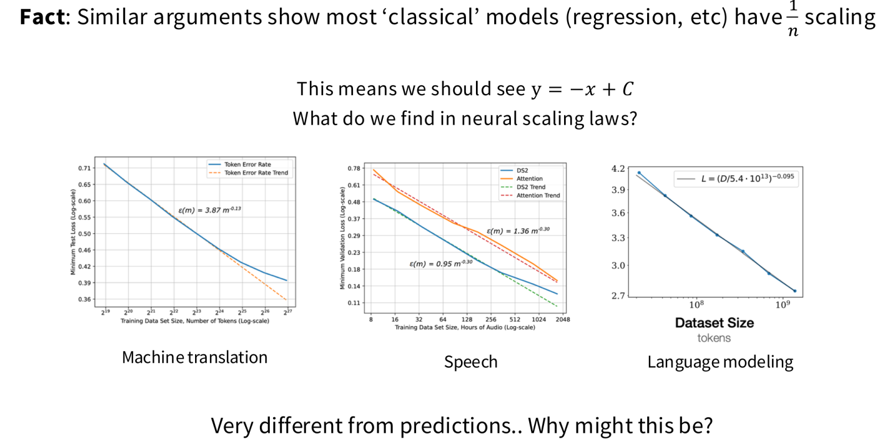

A widely accepted explanation links the scaling exponent to the **intrinsic dimensionality** of the data distribution. Under the manifold hypothesis, high-dimensional real-world data points lie on a lower-dimensional sub-manifold embedded within ambient space; the intrinsic dimension is the dimension of this underlying manifold. That said, reliably measuring intrinsic dimensionality in practice remains challenging, so this theory serves more as an intuitive framework than an absolute law.

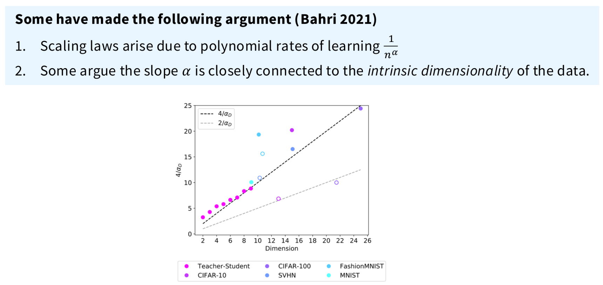

Another critical engineering question is data curation: does the **data mixture ratio** change the scaling behavior? Extensive empirical studies point to a clear rule of thumb: **varying the data mixture changes the intercept, not the slope**. Can we derive an analytical scaling law for arbitrary data mixtures? In practice, this is notoriously difficult: complex positive and negative transfer dynamics exist between domains, making cross-domain mixture extrapolation unreliable.

While modeling arbitrary mixtures is challenging, what about **data repetition**? Here, predictable scaling holds much better: experiments show that repeating high-quality tokens up to roughly 4 epochs yields performance indistinguishable from training on entirely unique tokens.

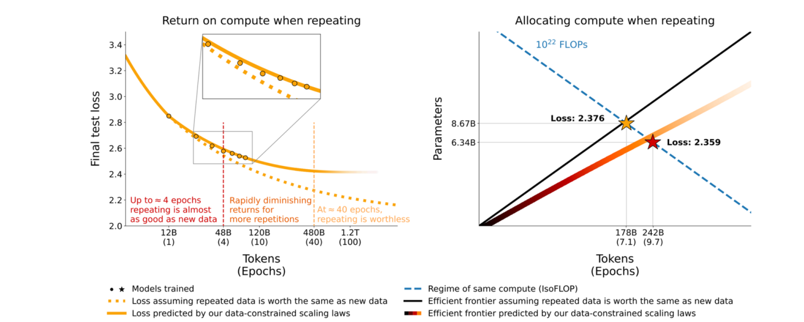

Pulling this together into actionable guidance for data curation: ***Under a constrained compute budget, train exclusively on ultra-filtered, high-purity tokens; under massive compute budgets, relax the filtering threshold to incorporate larger volumes of medium-quality tokens.***

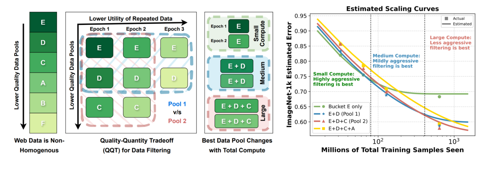

### Model Scaling Laws

At the architecture level, scaling laws help resolve critical engineering questions: Should we choose an LSTM-like recurrence or a Transformer? Which optimizer scales best? Under fixed parameter budgets, is a deeper model better than a wider one? Should we collect more data or scale GPU cluster capacity?

On **architecture selection**, no single formula reliably predicts cross-family performance; standard practice is to benchmark candidate architectures across smaller parameter scales and extrapolate their Pareto curves.

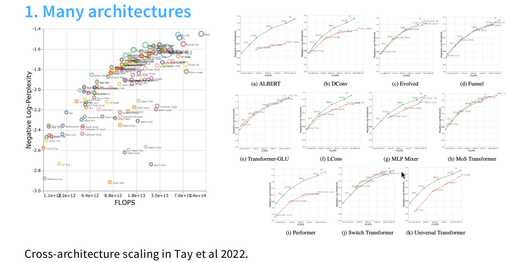

On **optimizer selection**, different optimizers yield virtually identical scaling slopes; differences show up purely as constant intercept offsets. Because early scaling law studies established that Adam and AdamW dominate across scales, AdamW remains the unchallenged default across industry.

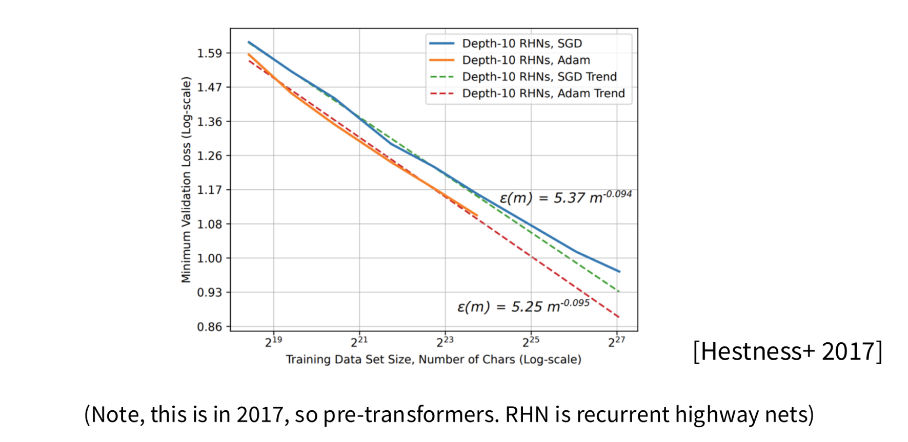

For **model depth**, the trend is consistent: provided the model is not pathologically shallow, deeper models consistently outperform shallower ones at equal parameter counts, albeit with diminishing returns as depth continues to scale.

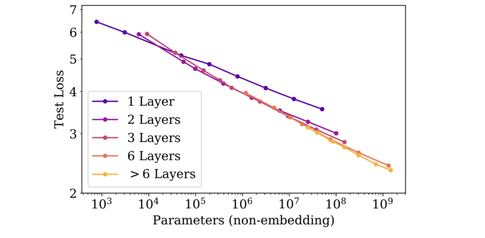

The **aspect ratio (width-to-depth ratio)** shifts slightly toward deeper architectures as models grow, but an aspect ratio around \(d_{\text{model}} / n_{\text{layer}} \approx 100\) serves as a remarkably robust default across a wide range of model sizes.

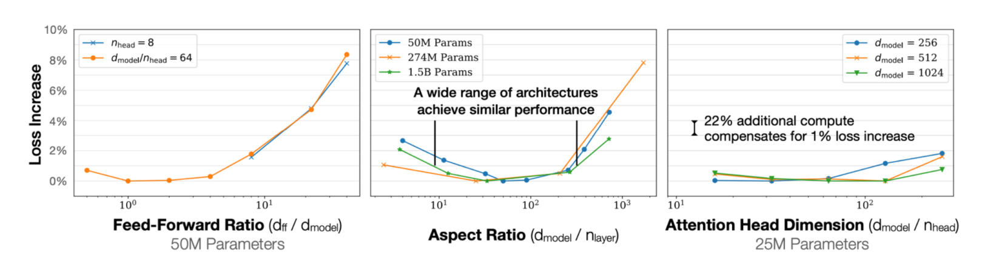

With Mixture-of-Experts (MoE) now standard in leading frontier models, MoE-specific scaling laws are essential. The high-level takeaway is straightforward: conditional computation reliably shifts the compute-performance frontier downward—larger sparse models consistently beat dense equivalents at matched training FLOPs.

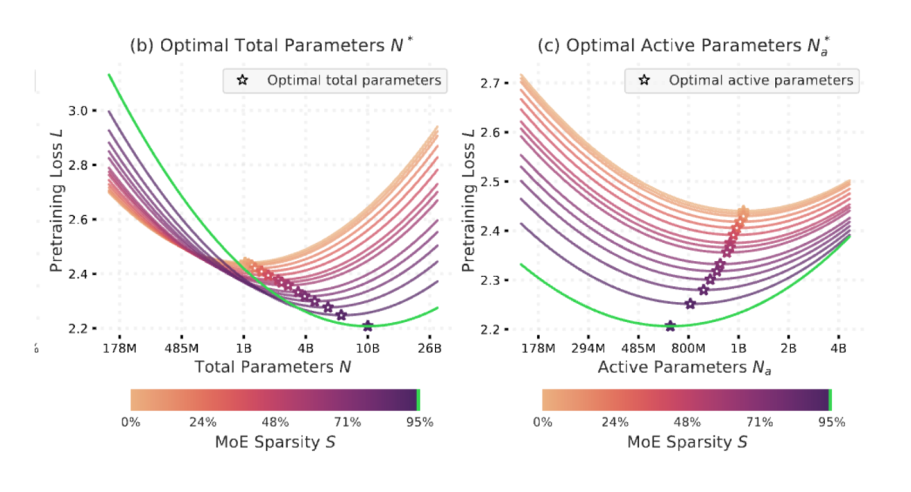

The **batch size** used in pretraining is another vital lever. Beyond a certain threshold—the **critical batch size**—further expanding the batch size fails to yield meaningful gradient noise reduction or sample efficiency gains. You can calibrate this critical batch size experimentally by picking a target validation loss, measuring the required gradient steps and total sample consumption across various batch sizes, and computing the ratio of their minima, \(\frac{E_{\text{min}}}{S_{\text{min}}}\).

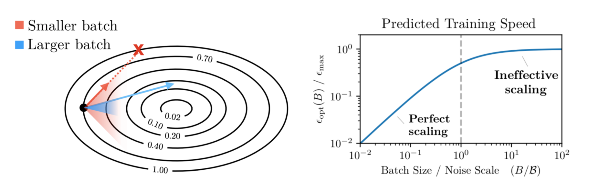

Finally, **learning rates** must adapt systematically as model dimensions scale. An effective framework is the Maximal Update Parametrization (\(\mu P\)), which coordinates learning rates and weight initialization across layers to ensure stable feature representations and smooth loss-frontier scaling across orders of magnitude.


### Disaggregating Parameters

An easy pitfall in scaling analysis is treating all model parameters uniformly. In reality, different parameter groups scale differently. In particular, **embedding parameters** follow distinctly different scaling dynamics compared to transformer block parameters: embedding capacity depends primarily on vocabulary size and context token diversity rather than non-linear model depth.


### Summary

The literature on scaling laws is vast, dense, and occasionally conflicting. Yet the core operating principle remains exactly what we emphasized at the outset: **use disciplined, small-scale experiments to extrapolate large-scale outcomes**. While published scaling curves offer indispensable baseline priors, landing a multi-million-dollar training run in production still requires running your own targeted small-scale sweeps to calibrate exact scaling exponents for your specific data mixture, architecture, and training stack.

## Data engineering

### Benchmarks

A core purpose of benchmarking is answering a simple question: just how "good" is a model? Of course, "good" is a vague notion. Translating intuitive expectations into concrete, quantifiable metrics is one of the hardest parts of designing benchmarks.

#### Perplexity

Perplexity is the most straightforward metric for measuring model performance. Because language models are trained directly to minimize training set perplexity, using perplexity on a held-out test set feels like the most natural way to gauge raw linguistic competence.

Today, perspectives on perplexity generally fall into two camps:

1. **Perplexity is everything**: If our training dataset truly mirrors real-world data distributions, relentlessly minimizing perplexity will eventually lead us to AGI.
2. **Perplexity isn't everything**: Perplexity assumes all tokens carry identical information value (or importance), which clearly isn't the case in reality.

> [!NOTE]- Take
> I currently lean toward the second camp because the first premise feels logically flawed: while a dataset can capture the distribution of natural language quite well, I don't believe language alone is an expressive enough representation to fully capture the true state of the physical world. In other words, here's a working hypothesis: if we rely purely on language to approximate the ground truth of the world, the required data volume might need to scale faster than exponentially.

#### Standardized Exams

Much like human exams, building this kind of benchmark allows us to tightly control subjects and difficulty levels. To keep grading objective and reproducible, questions are typically designed with a single, unambiguous correct answer. Here are a few notable examples:

Massive Multitask Language Understanding ([MMLU](https://arxiv.org/pdf/2009.03300.pdf)) spans 57 subjects where models must pick the right answer from multiple choices, as illustrated below. Despite its name, what this test actually measures has very little to do with core language understanding. 🐸

" )

Unsurprisingly, this benchmark has been virtually saturated. Here are the numbers as of October 24, 2026:

" )

Once the original MMLU was maxed out, [MMLU-Pro](https://arxiv.org/abs/2406.01574) was introduced—expanding the options from 4 to 10 and filtering out overly trivial questions. Predictably, this benchmark has also reached near-saturation by now. See the [data here](https://llm-stats.com/benchmarks/mmlu-pro).

---

As frontier models grew more capable, 2025 saw the release of Humanity's Last Exam ([HLE](https://arxiv.org/abs/2501.14249)). Widely discussed across the AI community, its difficulty truly lives up to its dramatic name.

" )

Even today, this benchmark is far from being genuinely saturated. Here are the figures from October 24, 2026:

" )

---

To sum up: exam-style benchmarks have become brutally difficult to keep pace with advancing models. However, exams are inherently detached from actual user workflows: real-world questions rarely have a single, rigid "correct" answer. When that gap widens, high exam scores don't necessarily translate into a good user experience.

#### Chat Evaluation

Chatting with a model in a browser is one of the most prominent real-world use cases. But this setting is dominated by open-ended prompts, and reliably grading answers to open-ended questions is notoriously tricky.

**Chatbot Arena** proposed a neat solution: bypass fixed human rubrics and judge models altogether. Real web users bring their own prompts, receive blind side-by-side responses from two random models, and vote on which answer is better. Using this crowdsourced win/loss data, we can apply an Elo-style rating system—just like in competitive chess—to rank the models' overall capabilities.

A key advantage of Arena is that no single biased judge dictates the scores for subjective prompts. That said, it isn't without flaws: crowd voters are fairly random, meaning they don't necessarily represent the model's target enterprise or expert user base; different voters apply conflicting personal standards; and accumulating enough head-to-head matches takes time, making Arena much slower to deliver feedback compared to instantaneous exam benchmarks.

---

Another mainstream route for handling open-ended queries is **LLM-as-a-Judge**: utilizing a capable, relatively impartial model to evaluate outputs against standardized guidelines. Examples include [AlpacaEval](https://tatsu-lab.github.io/alpaca_eval/) (2023) and [WildBench](https://arxiv.org/pdf/2406.04770) (2024), both of which employ GPT-4 or comparable frontier models as judges.

> [!NOTE] Note
> Many benchmarks of this style explicitly report their correlation with Chatbot Arena rankings. On one hand, this validates the benchmark's own methodology; on the other, it provides a fast proxy that circumvents Arena's scoring latency.

#### Agents

What makes agent benchmarks distinctive is that they test not just the foundation model, but the quality of the surrounding agent framework as well. Results consistently show that the framework's design often impacts final performance just as much as the base model itself! Furthermore, because agent frameworks vastly expand what models can do beyond simple text input and output, agent benchmarks tend to be remarkably rich. The task expectations are essentially on par with human job requirements—to the extent that a well-crafted LLM-agent pipeline can practically be scheduled and deployed like an autonomous human contributor.

#### Pure Reasoning

The motivation behind pure reasoning benchmarks is simple: what if we want to measure a model's raw problem-solving intellect rather than its breadth of memorized knowledge (even though knowledge remains undeniably critical)? By designing specialized puzzles, we can strip away domain background knowledge and isolate reasoning capacity.

A standout pioneer here is [ARC-AGI-1](https://arcprize.org/arc-agi) (2019), which presents tasks as multimodal, few-shot visual reasoning puzzles:

" )

In 2025, [ARC-AGI-2](https://arcprize.org/arc-agi) launched with a substantial jump in difficulty:


However, both iterations have now largely been saturated ([see Figure 1 in the technical report for a results summary](https://arcprize.org/media/ARC_AGI_3_Technical_Report.pdf)). In response, [ARC-AGI-3](https://arcprize.org/media/ARC_AGI_3_Technical_Report.pdf) was introduced this year (2026). Its signature feature is an interactive evaluation environment, reminiscent of retro handheld game consoles:

" )

> [!Warning] Food for Thought
> Can we ever truly separate intelligence from knowledge? Doesn't an interactive, handheld-game-style testing environment come baked with strong inductive biases and priors of its own? 🤔

#### Safety

"Safety" is another loosely defined term. A broad working consensus is: models should not produce outputs that violate laws, breach fundamental ethics, or pose catastrophic risks to humanity, and they should reliably refuse prompts that elicit harm.

Safety benchmarks are relatively fewer in number compared to the [Agents]() category, but classic examples include **HarmBench** ([Mazeika+ 2024](https://arxiv.org/abs/2402.04249)) and **AIR-Bench** ([Zeng+ 2024](https://arxiv.org/abs/2407.17436)).

#### Train-Test Contamination

One of the golden rules in introductory machine learning is: *never train on your test data*. In the pre-LLM era, this was trivial to follow. Today, it has become an excruciating challenge: training corpora are so monstrously large that keeping them 100% clean is virtually impossible.

A few strategies have surfaced to address this:

1. **Algorithmic contamination detection**: Leverage properties like test question order exchangeability. If a model exhibits significantly lower perplexity under a specific canonical ordering of questions, it strongly signals data leakage ([Oren+ 2023](https://arxiv.org/pdf/2310.17623)).
2. **Transparent reporting**: Model creators should publish formal contamination analysis audits ([Zhang+ 2024](https://arxiv.org/abs/2410.08385)).
3. **Evaluating on private datasets**: This is considerably more expensive. Worse, running the evaluation still requires transmitting the data over an API, leaving you with little choice but to hope the provider doesn't quietly stash a copy. 🐸

#### Takeaways

The value proposition of benchmarks is clear: they give us a signal of how capable a model is. But applying them effectively is tricky. Any individual dataset is inevitably biased and rarely matches our exact use cases. A reasonable rule of thumb: if a model excels on one specific dataset, take it with a grain of salt; if a model performs consistently well across a wide and diverse spectrum of benchmarks, chances are it's genuinely a great model.
