

This blog is mainly a note taking of [MIT MMAI](https://mit-mi.github.io/mmai-course/spring2026/) in spring 2026. After watching the video on YouTube, fairly to say, this course lacks technical details comparing to [CS336]() and [MIT 6.S184](). Maybe one main reason for this is some lecture videos are not public. Some courses offer slide but not video (see in [schedule](https://mit-mi.github.io/mmai-course/spring2026/schedule/)). And there is no offical homework repository but some students from MIT uploaded the homework to GitHub. Here is one [repo](https://github.com/hangzhao1006/Multi-Modal-AI).

## Overview

Multimodal literally means multiple modality. A more formal definition is the scientific study of **heterogeneous and interconnected (redundancy and synergy) data**.

The defining magic of multimodality is that it unlocks information hidden entirely within the interaction of heterogeneous data. Just like with a thunderstorm, you cannot determine its distance from lightning (vision) or thunder (audio) alone, but their time difference reveals exactly how far away it is.

> [!NOTE]- Illustration
> Where is the synergy information come from? It derives form your target task and highly depends on how the target can be represented by the known data.

Multimodal is very intuitively reasonable but not easy. There are 6 main challenges proposed by [Liang et al. 2023](https://arxiv.org/abs/2209.03430).

1. Representation: unimodal representation and cross-modal representation
2. Alignment: identifying and modeling cross-modal connections between all elements of multiple modalities
3. Reasoning: combine information from multimodal data and reasoning
4. Generation: generate raw modalities that reflects cross-modal interactions
5. Transference: transfer knowledge between modalities
6. Quantification: Empirical and theoretical study to better understand heterogeneity, cross-modal interactions, and the multimodal learning process.

The internal logic among the challenges is:

1. Raw data can be naturally gatherd into elements which is easier to interact with. (From trivial low-level elements to meaningful high-level elements)
2. Alignment is similar to representation but its abstraction level is higher.
3. Based on representation and alignment, we can conduct some inferential steps to generate something or enhance some modalities.
4. Finally, we need to generalize knowledge from the steps above to get better understanding of multimodal.

## Data and Heterogeneity

Heterogeneity is a basic property of multimodal data. But such an abstract word cannot produce much meaning. We need a more practical method to measure what is heterogeneity or how to profile a modality:

1. Element representation: How can we define the minimal meaningful unit? Is it discrete or continuous and how is its granularity.
2. Element distribution: How is the density and frequency of the basic representation unit in raw data?
3. Structure: What's the relation between basic representation units? Temporal or spatial? Latent or explicit?
4. Information: Considering how much the information a unit contains or the entropy of a unit.
5. Noise: Opposite to information, we need to take uncertainty into consideration.
6. Relevance: How much the modality contribute to your task?

> [!NOTE] Note
> Feeling confused? Take it easy. I'm also a little confused about this part. I see the motivation: we need a deeper investigation of modality. But how to put this into practice? 🤔

Based on the profile, we can decide how much data to collect, how to clean, visualize, evaluate the data. And finally, how to design model and learning algorithm based on the data itself.

### Unified view of Deep Learning Models

Here propose an inspiring view of what deep learning models actually do. The models only do two things:

1. Learn the representations for the basic meaningful unit.
2. Combine representations or information aggregation.

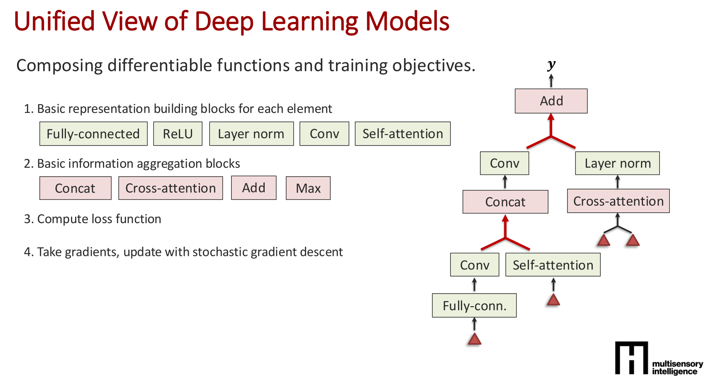

It seems that we can design arbitrary network to perform task. However, the topology and aggregation heavily affects the **invariance and equivariance** which means model maybe sensitive to some data transference while insensitive to other transference. For example, CNN is insensitive to the position and sensitive to the local patern. By remove unnecessary free weights, CNN needs much less data to get an effective representation.

> [!NOTE] Thought
> It's well known that CNN actually is constrained MLP and CNN is stronger than MLP when processing images. It's surprising that a "weaker" model performs better. Usually the invariance means spatial or temporal invariance, is there other invariance? Invariance can be learnt by extremely huge amount of data. So maybe other invariance is abstract and hard to reflect on the topology.

## Multimodal Fusion

There are some basic operation for multimodal fusion: additive fussion and multiplicative fussion. As shown here, it's a minimal implementation of multimodal fussion:

$$
y = \underset{\substack{\downarrow \\ \text{intercept} \\ \text{(bias term)}}}{w_0} + \underbrace{w_1 x_A + w_2 x_B}_{\substack{\text{Additive} \\ \text{terms}}} + \underbrace{w_3 (x_A \times x_b)}_{\substack{\text{Multiplicative} \\ \text{term}}} + \underset{\substack{\downarrow \\ \text{error} \\ \text{(residual term)}}}{\epsilon}
$$

Notablly, the multiplicative term is the basic way to describe the **interaction** of two modalities. Actually, multiplication is the basic unit that context-based attention can possibly emerge. For more information, refer to [Paul Liang's paper](https://arxiv.org/abs/2302.12247).

### Tensor Fusion

For the interaction of more modalities, we can use the *Tensor Fusion* trick which attach a constant \(1\) to each modality's representation. It's a graceful method to combine all we need to fuse modalities in one tensor: bias, unimodal and different levels of modality interaction.

" )

### Low-rank Fusion

However, the fused representation is large and its weight matrix maybe even larger. So it's quite reasonable to apply low-rank trick to get the *Low-rank Fusion*. Some relevant papers here: [Liu et al.](https://aclanthology.org/P18-1209/) and [Hu et al.](https://iclr.cc/virtual/2022/poster/6319)

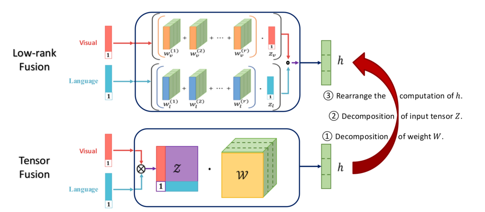

### Gated Fusion

If you do have a lot of modality, Tensor Fusion is too heavy. A more lightweight and also powerful fusion method is *Gated Fusion*.

" )

The form of gated fusion is addition but the weight of each modality is proposed by all modalities that remains the ability of multiplicative terms.

### Nonlinear Fusion

Instead of manually design functions to fuse modalities, it is attractive to replace the fuse function with a neural network which can represents complicated nonlinear function. But the network may not definitely learn the effective nonlinear interactions.

To detect how linear the nonlinear function is, we can use the [EMAP](https://aclanthology.org/2020.emnlp-main.62/). And the results is surprissing that we extremely over-estimated the nonlinear interaction and most of the final performance comes from simply addition. Besides, you'd commit that linear or additive model is such a simple but competitive baseline.

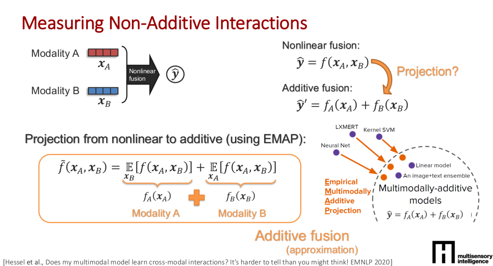

There are two possible reason for this:

1. Your task is simple and additive fusion can capture most of the interaction from your data.
2. You task and data is complex and need nonlinear functions to perform well but your training method fails to capture the nonlinear interactions.

How can we push it to learn more nonlinear interaction? We can use the idea of residual: nonlinear interaction should be the patches to explain the error that linear terms can not explain.

" )

### Summary

How to choose the fuse method? It highly depends on how heterogeneous your modalities is:

1. Homogeneous: additive fusion or tensor fusion
2. Little heterogeneous: gated fusion, modality-shift fusion or nonlinear fusion
3. Heterogeneous: dynamic early fusion or customized optimization

Is't not a rigorous rule but to provides some intuition. In practice, you may need to do some experiments to prove that there do have amount of synergy in your data. And then you apply more complex algorithms to exploit that synergy.

## Alignment

Alignment mainly refers to identifying and modeling cross-modal connections between all elements of multiple modalities.

### Discrete Alignment

The simplest connection is discrete and pair-wise connection (alignment). We are trying to find the corresponding element from the other modality. To formulate this intuition, we can define a general process of pairing modality elements:

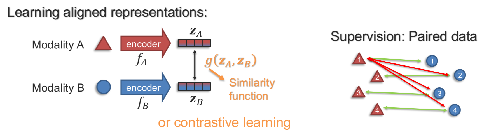

We get the representation of A is \(\mathbf{z}_{A}=f_{A}(X_{A})\) and the representation of B is \(\mathbf{z}_{B}=f_{B}(X_{B})\). We need to learn a function \(g(\mathbf{z}_{A}, \mathbf{z}_{B})\) to score the similarity of the two representations. There are many choices of \(g(\mathbf{z}_{A}, \mathbf{z}_{B})\):

1. Cosine similarity: \(g(\mathbf{z}_A, \mathbf{z}_B) = \frac{\mathbf{z}_A \cdot \mathbf{z}_B}{\|\mathbf{z}_A\| \|\mathbf{z}_B\|}\)
2. Kernel similarity: \(k(\mathbf{z}_{A}, \mathbf{z}_{B})\), the kernel can be linear, polynomial et.
3. Canonical Correlation Analysis
4. Hierarchy of unimodal: not to directly calculate the similarity between two elements but to find the similar hierarchy or local patern between the modalities. (bit of abstract😅)

All the method above need a predefined function to get the similarity or the object we need to optimize (actual paired element in training set should be more similar). *Contrastive Learning* offers an opportunity to learn the representation without directly optimizing the similarity. The key idea of contrastive learning is to gather the paired smaples and push away unpaired samples. For more details refer to [Lilian's blog](https://lilianweng.github.io/posts/2021-05-31-contrastive/).

However, Contrastive Learning is not the silver bullet for multimodal alignment. Its performance highly depends on your task.The actual thing contrastive learning does is to maximum the lower boundary of mutual information or *redundancy* in information theory.

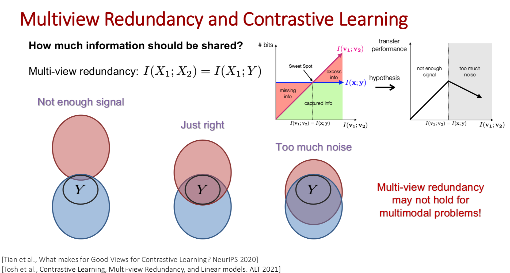

### Global Alignment

The [Discrete Alignment]() need a set of paired data, but can we get the representation that without knowing pairing label? And what about the number of sample from each modality is not equal? And it's common that one sample from modality A corresponds to multiple samples from modality B. How to tackle this? These are the problems that *Global Alignment* tries to solve.

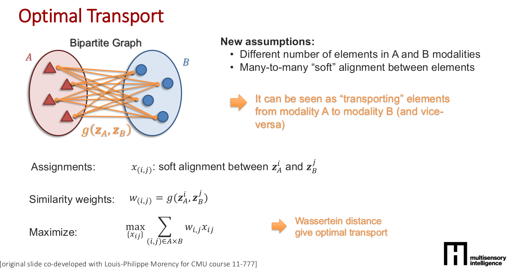

The solution is quite straight-forward: framing it as an optimal transport problem which can be efficiently solved with Sinkhorn Algorithm ([Entropic regularization](https://en.wikipedia.org/wiki/Transportation_theory_(mathematics)#Entropic_regularization)).

### Continuous Alignment

The core hypothesis above is we can easily get discrete elements. But the data sampled by sensor is naturally continuous and it's a nontrivial work to tackle it.

Traditionally, we tackled this by aligning continuous signals directly without segmenting them. An approach known as *continuous warping*. Methods such as Canonical Time Warping (CTW) and Dynamic Time Warping (DTW) find a non-linear warping path across time, effectively stretching or compressing the temporal axis so that corresponding continuous trajectories (e.g., human actions performed at different speeds) become synchronized.

Alternatively, another route is *discretization*, which seeks to transform continuous streams into discrete units so standard discrete alignment techniques can be applied. While manual or rule-based segmentation often suffers from ambiguous boundaries and many-to-one alignment issues (e.g., many continuous acoustic frames corresponding to a single phoneme), modern representation learning bridges this gap via self-supervised quantization. Techniques like [HuBERT](https://arxiv.org/abs/2106.07447) for speech and [VQ-VAE](https://arxiv.org/abs/1711.00937) for vision quantize continuous feature spaces into discrete codebook tokens (e.g., via k-means or vector quantization). This essentially "textifies" continuous audio and visual modalities into discrete token sequences, allowing them to be aligned and processed seamlessly within unified Transformer architectures.

### Implicit Alignment

It's actually a hypothesis that the embedded representations of an object in different modalities from isolated trained models are gradually converging to a more similar representation with the performance of model increasing. The motivation behind this claim is that the models are learning the same object and with the model getting better understanding the representation should be converging even without specified alignment since they are learning the same object.

" )

### Representation Fission

Sometimes we may want to get a deeper insight of the internal structure of multiple modalities. For example, we want to estimate how much redundancy among these modalities and hwo to represent that.

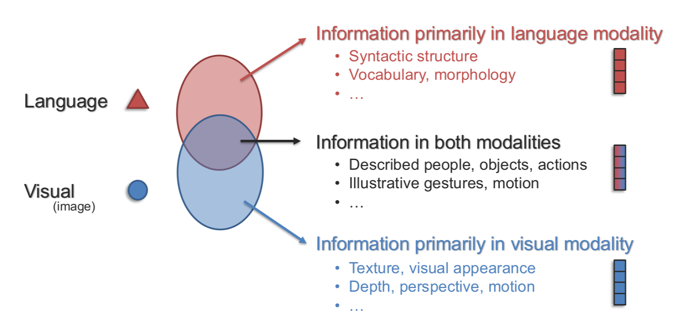

There are two method to achieve our goal:

1. Maximize mutual information: \(I(\mathbf{z};x_{A})\) and \(I(\mathbf{z};x_{B})\), the representation \(\mathbf{z}\) should contrain as much as possible information in both modalities.
2. Minimize conditional entropy: \(H(\mathbf{z}|x_{A})\) and \(H(\mathbf{z}|x_{B})\), given any modality the target representation \(\mathbf{z}\) should be as less uncertain as possible.

In practice, we apply *Factorized Contrastive Learning* to make that work.

" )

## Large Multimodal Models

Follow the tendency of "Transformerize everything", we can get the Large Multimodal Models. The outline of this part is clear:

1. Discretization: literally tokenize everything to get multimodal representations
2. Attention: treat the text tokens as queries to absorb (attend) multimodal informations. Or you can do the oppsite (multimodal tokens as queries) simultaneously to conduct multimodal autoregression.
3. Train on your downstrea tasks

One classical work is [Uniter](https://arxiv.org/abs/1909.11740) and its architecture is showed below. You can train the model on mutiple tasks to get a better representation.

" )

Another classical work is [ViLT](https://arxiv.org/abs/2102.03334). A super simple and straight-forwrd method but works pretty well. You can simply view ViLT as the conbination of ViT (vision only) and BERT (text only).

" )

And you can get a quite interpretable result from ViTL.

" )

### Non-native VLMs

Instead of training a large multimodal model from scratch, can we simply inject some visual information into pure language model to get a "multimodal model"? The answer is yes and it works surprisingly well.

" )

Here you just take an adapter to project the image into the text embedding space and concatenate with plain text tokens (prefix) and train on the plain text autoregression task.

Especially, the [Flamingo](https://arxiv.org/abs/2204.14198) model demonstates a strong general ability based on the powerful language model.

" )

Flamingo proves that the adapter multimodal model can beat the native multimodal model.

" )

You may wonder why the dominant models today is not adaper multimodal model since Flamingo beats so many competitors? Or what's the disadvantage of adapter models?

Flamingo wins on the time. Early in 2022, the native multimodal model is small and there is no mature example of large scale multimodal training. But currently, large-scale native multimodal training has been demonstrated to be feasible with **fewer hallucination** and **more precise visual comprehension**.

> [!NOTE] Thought
> Another evidence that end-to-end training will finally beats adapter training. Also it proves that there is quite amount of [nonlineaar synergy]() between language and vision.

### Native Multimodal Models

The "LLM" is trained from scratch with multimodal input. We can do this via early fusion or late fusion.

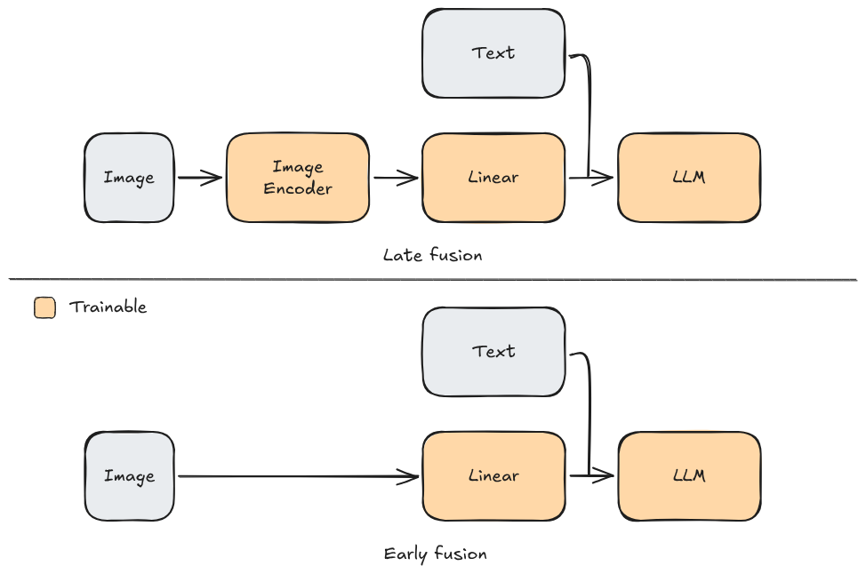

## Multimodal Generation

### Image Retrieval

Comparing to plain text response, image retrieval enables model to reply with images that is quite similar to what we do in WeChat. If the database is huge enough, you can view it as a kind of "generation".

" )

Image captioning task trains the visual encoder which maps image into tokens, enabling LLM understanding your images. In image-text retrieval training, the model introduces a special token "RET" which contrains the previous context. Then via constractive learning, the model can retrieve the most relevant image from database.

" )

You can obviously train LLM to generate image tokens and map them to embeddings that SD decoder can recognize.

> [!NOTE] Tip
> As you notice that the images is represented by a series of tokens instead of a high dimensional token. It's more stable and efficient.

### VAE

Here Paul analyses the VAE from the perspective of *Mixture of Gaussians*: the encoder and decoder of VAE is mixtures of Gaussian distribution whose \(\mu\) and \(\sigma\) is generated by a neural network according to the input data. There is another perspective to comprehend VAE,  see in [VAE in flow matching]().

### Diffusion Models

Instead of viewing it as a stochastic version of [flow matching](), diffusion model can also be viewed as series of VAE without compressing the representation space.

" )

> [!NOTE] Attachment
> One interesting paper proposed by [Tianhong Li](https://arxiv.org/abs/2511.13720) argues that we should not to learn the velocity field since the velocity field is the combination of target image and noise (\(v=x-\epsilon\)) where the noisy item is hard to learn.

## Multimodal Reasoning

Firstly, what's reasoning? It's usually defined as to combine different informations including real time sampled data and the ingerent information in model weight to conduct normally multiple inference steps to get the answer for a complex problem. Multimodal reasonning is quite similar to normal reasoning but with various modalities input.

Three common method to reason:

1. Via discrete prompting without model training.
2. Supervisd fine-tuning but you need to prepare high-quality reasoning trace. Also a method of distillation.
3. Reinforce Learning which does not require whole trace and driven by reward function.

Today, RL is almost the representation of "reasoning". More information about RL should be left to other notes since the course does not involve a overall and clear architecture of RL.

## Multimodal Interaction

Comparing to multimodal reasning, model can get real-time feedback form the environment in multimodal interaction settings. Under the interactive settings, a more appropriate term for the model is "agent". And here is an architerture to view the agent systems.

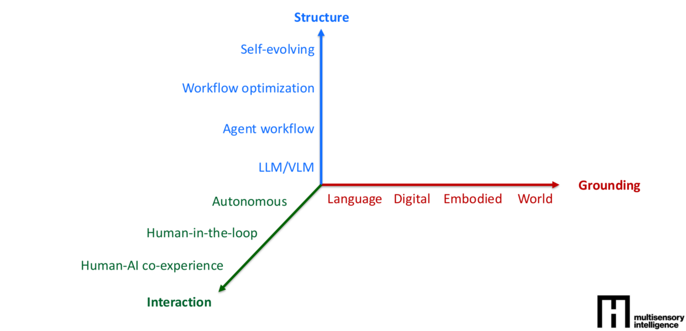

There are three axes of agent system:

1. Grounding: how is the data form of feedback for agent
2. Structure: how we compose the behaviour structure of agent
3. Interaction: how the agent interacts with human

> [!NOTE] Tips
> Such a method of decoupling a complex system into perpendicular axes is generally useful.

One typical environment for multimodal agent is the real web controlling tasks ([VisualWebArena](https://arxiv.org/abs/2401.13649)). In this benchmark, agent is required to conduct multi-step operation on the real website to complete the task. Here is an exmaple.

" )

The common failure modes is:

1. Visual processing failures: clicking wrong item or spatial reasoning (e.g. what's the production in the first row?)
2. Long horizen reasoning and planning: the agent may get stuck in loops since the multimodal input is really context expensive.

A possible method to deal with the first problem is marking the HTML more detailly for agent just like what we do in image processing. ([Set-of-Marks](https://arxiv.org/abs/2310.11441))

" )

A recent research to tackle long horizen task is to compress the previous information in to "internal state". It's bit of similar to *Linear Attention* method.

" )

## Cross-modal Transfer

It comes from the phenomenon that the data from one modality may help the other one get better representation or performance.

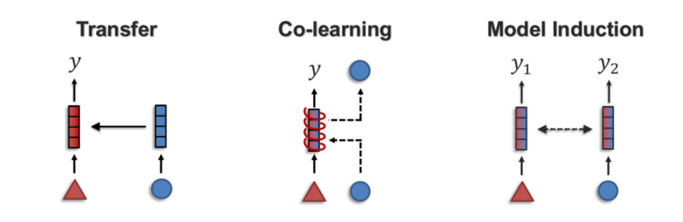

The overall method to achieve transference is constructing an data path to let the auxiliary data participate in the training. It can be directly fusing with primary modality data, treating auxiliary modality data as training target or using two model for each modality to label for each other. All the previous training way can be used here.

The most notable part is model induction which keeps individual unimodal models separate but induces common behavior across separate models.

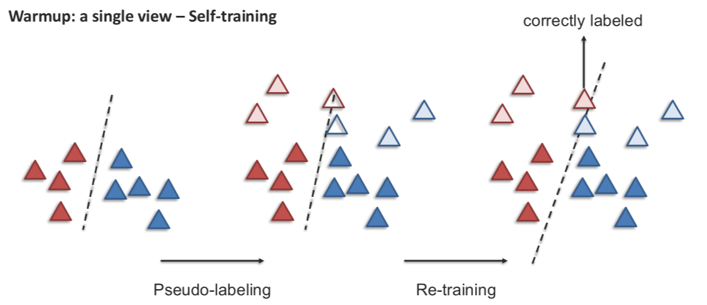

A typical form of model induction is self-training. The main process of self-training is similar to online-policy RL: You first train a model on the initial data set to get the first model. Then more data can be labeled by the trained model (pseudo-labeling). And the model can be retrained with new labeled data. By repeating the process, you can finally get a better model than the naive one trained only on the original data.

## Sclaing Laws

Due to the fame of [scaling laws in LLM](), it's interesting to know how the multimodal model behave when scaling. Generally the unimodal scaling law follows the Chinchilla Scaling Law form and the multimodal scaling law captures the synergy and competition among modalities.

" )

> There are many errors in this paper. And the last term of the second formula should be \((|D_i| + |D_j|)^{\beta_{i,j}}\)

Is there some difference of early fusion and late fusion? Actually not too much and early fusion is better.

" )
