

这篇博客主要是 2026 年春季 [MIT MMAI](https://mit-mi.github.io/mmai-course/spring2026/) 课程的学习笔记。看完 YouTube 上的视频后，平心而论，这门课的技术细节不如 [CS336]() 和 [MIT 6.S184]() 扎实。一个主要原因可能是部分课程视频没有公开，在[课程表](https://mit-mi.github.io/mmai-course/spring2026/schedule/)里，有些课只提供了幻灯片而没有视频。此外也没有官方的作业仓库，不过一些 MIT 的学生把作业传到了 GitHub 上，可以参考这个[仓库](https://github.com/hangzhao1006/Multi-Modal-AI)。

## 概述

多模态字面意思就是多种模态，更严谨的定义是对**异质且相互关联（包含冗余与协同）的数据**进行的科学研究。

多模态真正的魔力在于，它能挖掘出完全隐藏在异质数据交互中的信息。就像一场雷暴，单靠闪电（视觉）或单听雷声（听觉），你都无法判断它离你有多远；但两者之间的时间差，却能精确揭示出距离。

> [!NOTE]- 说明
> 协同信息从何而来？它源于你的目标任务，并且高度依赖于已知数据能够在多大程度上表征该目标。

多模态听起来非常符合直觉，做起来却并不容易。[Liang 等人（2023）](https://arxiv.org/abs/2209.03430)总结了六大核心挑战：

1. 表征：单模态表征与跨模态表征
2. 对齐：识别并建模多模态所有元素间的跨模态关联
3. 推理：结合多模态数据中的信息进行推导
4. 生成：生成能够体现跨模态交互的原始模态数据
5. 迁移：在模态之间迁移知识
6. 量化：通过实证与理论研究，更深入地理解异质性、跨模态交互以及多模态学习过程

这六大挑战之间的内在逻辑如下：

1. 原始数据可以自然地聚合成更易于交互的基本元素（从琐碎的低层元素到有意义的高层元素）。
2. 对齐与表征类似，只是抽象层级更高。
3. 基于表征和对齐，我们可以进行推理，进而生成新内容或增强某些模态。
4. 最后，我们需要从上述步骤中提炼规律，从而更透彻地理解多模态。

## 数据与异质性

异质性是多模态数据的基本属性。但如此抽象的词汇本身没法提供太多信息，我们需要更实用的方法来度量异质性，或者说“刻画”一个模态的特征：

1. 元素表征：如何定义最小的语义单元？它是离散的还是连续的，粒度如何？
2. 元素分布：基本表征单元在原始数据中的密度和频率是怎样的？
3. 结构：基本表征单元之间是什么关系？时间关系还是空间关系？隐式的还是显式的？
4. 信息量：每个单元包含多少信息，或者说它的信息熵有多大？
5. 噪声：与信息量相对，我们还需要考虑不确定性。
6. 相关性：该模态对你的任务有多大贡献？

> [!NOTE] 笔记
> 感到有点晕？放轻松，我刚开始看这部分也挺迷糊的。我能理解它的动机——我们需要对模态做更深入的剖析，但具体怎么落地到实践中呢？🤔

基于这些特征画像，我们就能决定要采集多少数据，以及如何清洗、可视化和评估数据，并最终指导模型结构与学习算法的设计。

### 深度学习模型的统一视角

这里提出了一个很有启发的观点来解释深度学习模型究竟在做什么——模型其实只做两件事：

1. 学习基本语义单元的表征。
2. 组合表征，或者说进行信息聚合。

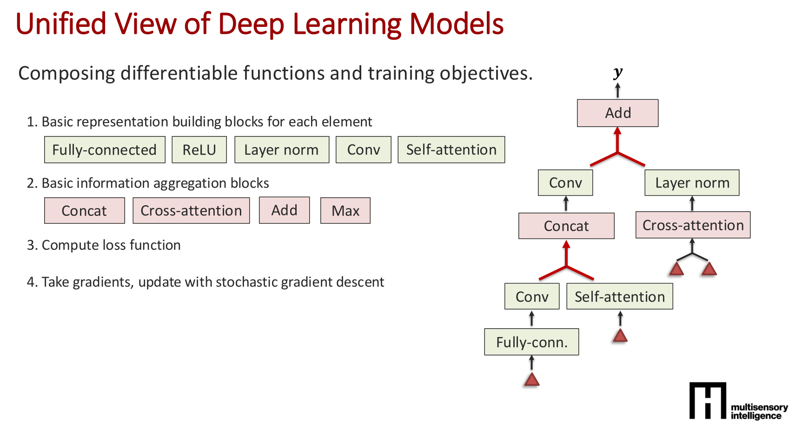

表面上看，我们可以随意设计网络来完成任务。但实际上，网络拓扑和聚合方式会深刻影响模型的**不变性与等变性**，这意味着模型可能对某些数据变换敏感，而对另一些不敏感。例如，CNN 对位置不敏感，但对局部模式敏感。通过去掉不必要的自由权重，CNN 只需要少得多的数据就能学到有效的表征。

> [!NOTE] 思考
> 众所周知，CNN 本质上是受限的 MLP，但在处理图像时却比 MLP 强得多。一个“能力更弱”的模型反而表现更好，这挺令人惊讶的。通常我们说的不变性指空间或时间不变性，那还存在其他的不变性吗？不变性其实也可以靠海量数据硬学出来，所以也许存在一些更抽象、难以直接体现在网络拓扑上的不变性。

## 多模态融合

多模态融合有一些基础操作：加法融合与乘法融合。下面是一个多模态融合的极简实现：

$$
y = \underset{\substack{\downarrow \\ \text{intercept} \\ \text{(bias term)}}}{w_0} + \underbrace{w_1 x_A + w_2 x_B}_{\substack{\text{Additive} \\ \text{terms}}} + \underbrace{w_3 (x_A \times x_b)}_{\substack{\text{Multiplicative} \\ \text{term}}} + \underset{\substack{\downarrow \\ \text{error} \\ \text{(residual term)}}}{\epsilon}
$$

值得注意的是，乘法项是刻画两个模态之间**交互**的最基本方式。实际上，乘法正是基于上下文的注意力机制得以涌现的底层基础。更多细节可参考 [Paul Liang 的论文](https://arxiv.org/abs/2302.12247)。

### 张量融合

对于更多模态之间的交互，可以使用*张量融合*技巧，即在每个模态的表征后拼接一个常数 \(1\)。这是一种非常优雅的方式，能把融合所需的全部要素——偏置项、单模态信息以及不同层级的模态交互——统一放进同一个张量里。

" )

### 低秩融合

不过，融合后的表征维度很大，对应的权重矩阵更是庞大。因此，顺理成章地可以引入低秩分解技巧，得到*低秩融合*。相关论文可参考：[Liu 等人](https://aclanthology.org/P18-1209/) 和 [Hu 等人](https://iclr.cc/virtual/2022/poster/6319)。

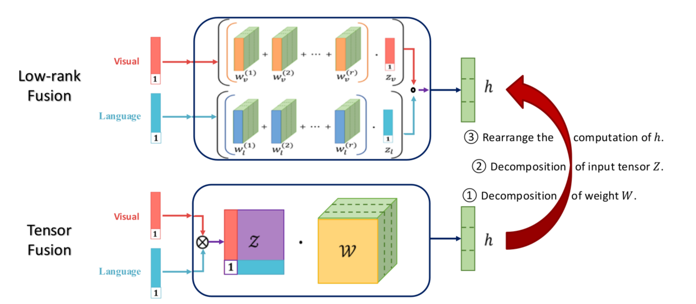

### 门控融合

如果你有很多模态，张量融合就会显得过于笨重。一种更轻量且同样强大的替代方案是*门控融合*。

" )

门控融合在形式上是加法，但每个模态的权重是由所有模态共同决定的，从而保留了乘法项的交互能力。

### 非线性融合

与其手动设计融合函数，不如直接用神经网络来代替，毕竟神经网络能拟合复杂的非线性函数。然而，网络未必真的能学到有效的非线性交互。

为了检测非线性函数到底有多“线性”，可以使用 [EMAP](https://aclanthology.org/2020.emnlp-main.62/)。结果令人意外：我们极大地高估了非线性交互的贡献，最终性能的大部分其实仅仅来自简单的加法。此外，你也不得不承认，线性或加法模型虽然简单，却是个极具竞争力的基线。

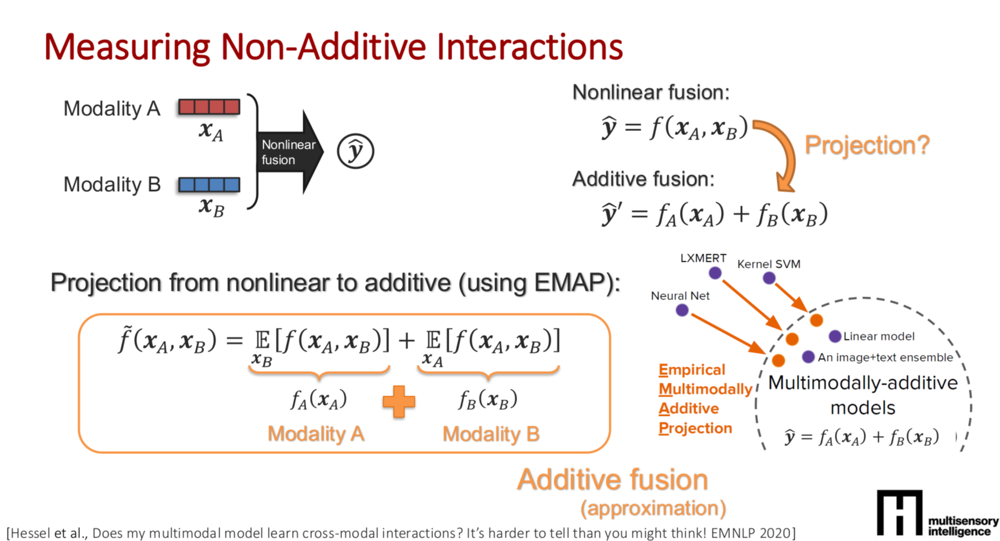

出现这种现象可能有两个原因：

1. 你的任务比较简单，加法融合就已经足够捕获数据中的大部分交互信息。
2. 你的任务和数据确实复杂，需要非线性函数才能做好，但目前的训练方法没能成功学出这些非线性交互。

那么，如何倒逼模型学到更多的非线性交互呢？我们可以借鉴残差的思想：把非线性交互看作“补丁”，专门用来拟合线性项无法解释的误差。

" )

### 小结

该如何选择融合方式？这高度取决于你手中模态的异质程度：

1. 同质性高：加法融合或张量融合
2. 轻微异质：门控融合、模态偏移融合或非线性融合
3. 高度异质：动态早期融合或定制化优化方案

这并不是一条死板的规则，只是提供一些直觉参考。在实践中，你往往需要先做实验，验证数据里确实存在足够多的协同信息，然后再去上更复杂的算法来挖掘这些协同效应。

## 对齐

对齐主要指识别并建模多个模态所有元素之间的跨模态关联。

### 离散对齐

最简单的关联是离散且成对的关联，核心是试图从另一个模态中找到对应的元素。为了将这一直觉形式化，我们可以定义一个通用的模态元素配对流程：

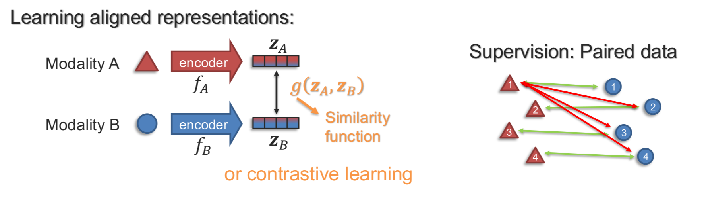

我们得到模态 A 的表征 \(\mathbf{z}_{A}=f_{A}(X_{A})\) 和模态 B 的表征 \(\mathbf{z}_{B}=f_{B}(X_{B})\)，接着需要学习一个函数 \(g(\mathbf{z}_{A}, \mathbf{z}_{B})\) 来给两者的相似度打分。\(g(\mathbf{z}_{A}, \mathbf{z}_{B})\) 有多种选择：

1. 余弦相似度：\(g(\mathbf{z}_A, \mathbf{z}_B) = \frac{\mathbf{z}_A \cdot \mathbf{z}_B}{\|\mathbf{z}_A\| \|\mathbf{z}_B\|}\)
2. 核相似度：\(k(\mathbf{z}_{A}, \mathbf{z}_{B})\)，核函数可以是线性的、多项式的等等。
3. 典型相关分析
4. 单模态层级结构：不直接计算两个元素之间的相似度，而是去寻找两个模态之间相似的层级结构或局部模式。（这有点抽象😅）

上述方法都需要预先定义一个相似度计算方式或优化目标（比如训练集中真正配对的元素应当更相似）。而*对比学习*提供了另一种思路，无需直接去显式优化相似度，其核心思想是把配对的样本拉近、把未配对的样本推远。更多细节可参考 [Lilian 的博客](https://lilianweng.github.io/posts/2021-05-31-contrastive/)。

不过，对比学习并非多模态对齐的万能药，它的效果高度依赖于具体任务。对比学习本质上是在最大化互信息的下界，也就是信息论中的*冗余*。

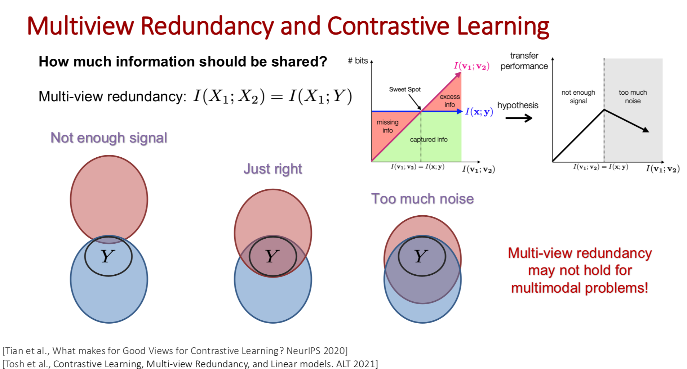

### 全局对齐

[离散对齐]()依赖一组配对好的数据，但如果不知道配对标签，还能学出对应表征吗？如果每个模态的样本数量不相等怎么办？而且现实中经常出现模态 A 的一个样本对应模态 B 的多个样本。这些问题正是*全局对齐*要解决的。

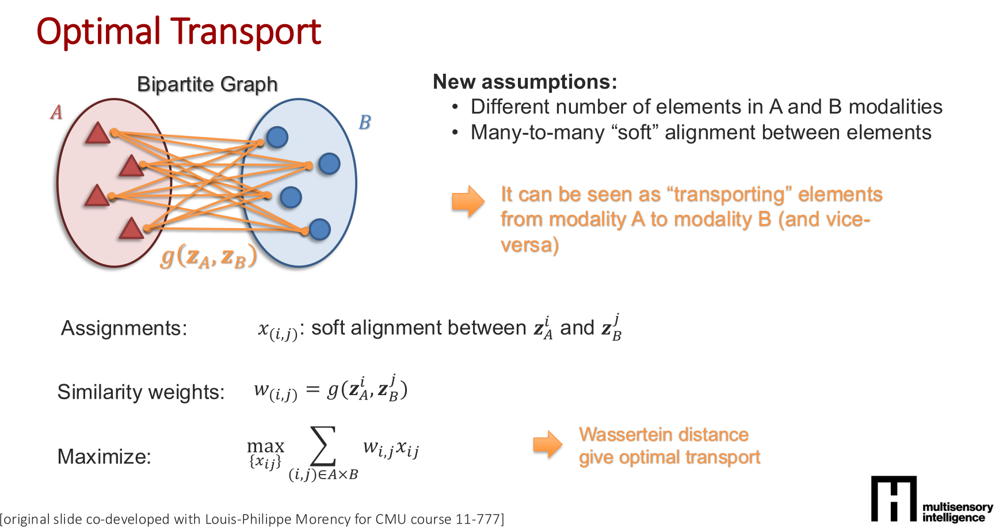

解法相当直接：将其建模为一个最优传输问题，然后用 Sinkhorn 算法高效求解（[熵正则化](https://en.wikipedia.org/wiki/Transportation_theory_(mathematics)#Entropic_regularization)）。

### 连续对齐

上面讨论的核心前提是我们可以轻松拿到离散元素。但传感器采集的数据天然是连续的，处理起来绝非易事。

传统上，我们会直接对齐连续信号而无需先做切分，这种方法称为*连续规整*。诸如规范时间规整和动态时间规整等方法，会在时间轴上寻找一条非线性规整路径，通过拉伸或压缩时间维度，让对应的连续轨迹（比如以不同速度完成的同一人类动作）实现同步。

另一条路径则是*离散化*，试图把连续数据流转化为离散单元，从而套用标准的离散对齐技术。手动或基于规则的切分往往会面临边界模糊和一对多对齐的难题（例如，许多连续的声学帧才对应一个音素），而现代的表征学习通过自监督量化弥合了这一鸿沟。像语音领域的 [HuBERT](https://arxiv.org/abs/2106.07447) 和视觉领域的 [VQ-VAE](https://arxiv.org/abs/1711.00937)，都能把连续特征空间量化为离散码本中的词元（例如通过 k-means 或矢量量化）。这相当于把连续的音频和视觉模态“文本化”为离散词元序列，使它们能够无缝接入统一的 Transformer 架构中进行对齐与处理。

### 隐式对齐

这其实是一个假说：对于同一个物体，在不同模态上各自独立训练的模型，随着模型性能的提升，它们学到的嵌入表征会逐渐趋同。背后的动机是：既然这些模型都在学习同一个客观对象，随着理解不断加深，即便没有显式地去做对齐，它们的表征也理应逐渐收敛到相似的空间。

" )

### 表征分解

有时我们希望能更深入地洞察多模态内部的组成结构，比如估计这些模态之间有多少冗余，以及该如何把它们表示出来。

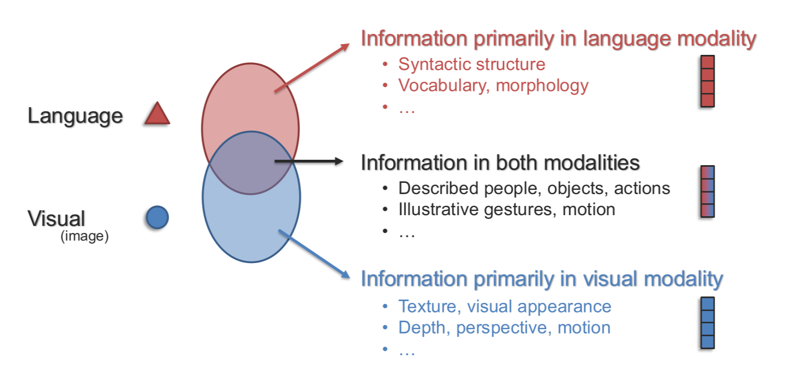

要实现这一目标有两个思路：

1. 最大化互信息：\(I(\mathbf{z};x_{A})\) 和 \(I(\mathbf{z};x_{B})\)，表征 \(\mathbf{z}\) 应当尽可能多地包含两个模态中的信息。
2. 最小化条件熵：\(H(\mathbf{z}|x_{A})\) 和 \(H(\mathbf{z}|x_{B})\)，在给定任意一个模态时，目标表征 \(\mathbf{z}\) 的不确定性应当尽可能小。

在实践中，我们采用*因子分解对比学习*来实现这一思路。

" )

## 多模态大模型

顺着“万物皆可 Transformer”的趋势，就诞生了多模态大模型。这一部分的脉络非常清晰：

1. 离散化：把所有模态都切分成词元，得到多模态表征。
2. 注意力机制：将文本词元作为查询向量来吸收多模态信息；或者反过来，同时把多模态词元也作为查询向量，实现多模态自回归。
3. 在下游任务上进行训练。

一个经典工作是 [Uniter](https://arxiv.org/abs/1909.11740)，其架构如下图所示。可以在多个任务上联合训练该模型，以获得更好的表征。

" )

另一个经典工作是 [ViLT](https://arxiv.org/abs/2102.03334)，方法极其简单直接，但效果相当不错。你可以直接把 ViLT 看作 ViT（纯视觉）和 BERT（纯文本）的结合体。

" )

而且你能从 ViLT 中得到颇具可解释性的结果。

" )

### 非原生视觉语言模型

除了从头训练一个多模态大模型，我们能不能只往纯语言模型里注入一些视觉信息，就得到一个“多模态模型”呢？答案是肯定的，而且效果出奇地好。

" )

具体做法就是用一个适配器把图像映射到文本嵌入空间，拼接到纯文本词元前面作为前缀，然后继续在纯文本自回归任务上训练。

尤其是 [Flamingo](https://arxiv.org/abs/2204.14198) 模型，凭借强大的语言模型底座，展现出了极强的通用能力。

" )

Flamingo 证明了基于适配器的多模态模型甚至能击败原生多模态模型。

" )

你可能会好奇：既然 Flamingo 击败了那么多对手，为什么如今的主流模型却不是这种适配器路线呢？或者说，适配器模型有什么缺点？

Flamingo 赢在了时间点上。早在 2022 年，原生多模态模型的规模还很小，当时也没有成熟的大规模多模态训练范式。但放到现在，大规模原生多模态训练已经走通了，并且表现出**幻觉更少**、**视觉理解更精准**的优势。

> [!NOTE] 思考
> 这又一次证明了端到端训练最终会战胜适配器训练，同时也说明语言和视觉之间确实存在相当可观的[非线性协同效应]()。

### 原生多模态模型

也就是用多模态输入从头训练整个大模型，这可以通过早期融合或晚期融合来实现。

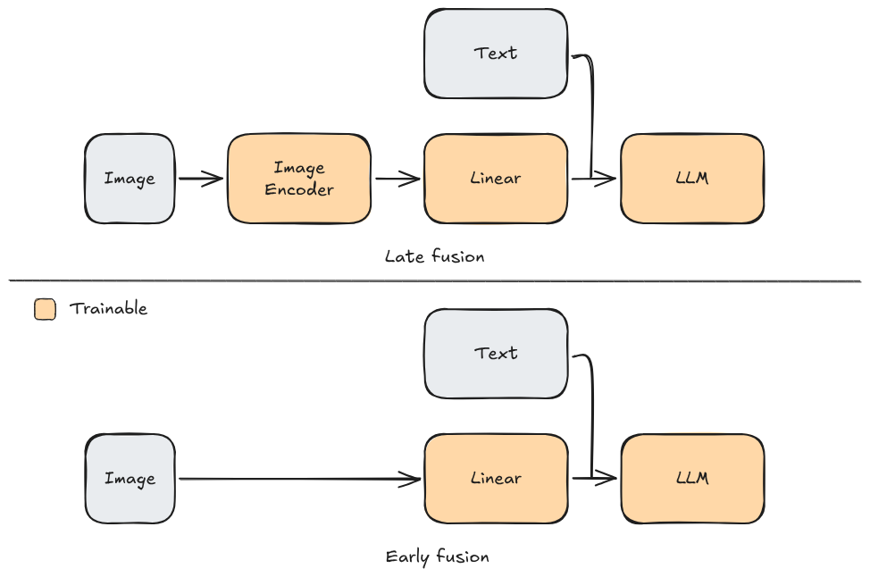

## 多模态生成

### 图像检索

相比纯文本回复，图像检索让模型能够直接用图片回应，就像我们在微信里发图交流一样。只要数据库足够大，你甚至可以把它看作一种“生成”。

" )

图像描述任务负责训练视觉编码器，把图像映射成词元，使语言大模型能够看懂图片。而在图文检索训练中，模型引入了一个特殊的 `RET` 词元来汇总前文语境，再通过对比学习从数据库中检索最相关的图像。

" )

显然，你也可以训练语言大模型直接生成图像词元，再把它们映射到 SD 解码器能识别的嵌入向量上。

> [!NOTE] 提示
> 注意到这里图像是用一连串词元来表示的，而不是单一的高维向量，这样训练起来更稳定也更高效。

### VAE

这里 Paul 从*高斯混合模型*的视角剖析了 VAE：VAE 的编码器和解码器本质上都是高斯混合分布，其均值 \(\mu\) 和标准差 \(\sigma\) 由神经网络根据输入数据生成。关于 VAE 还有另一种理解视角，可参考[流匹配中的 VAE]()。

### 扩散模型

除了把它看作[流匹配]()的随机版本，扩散模型也可以被视为一系列不做表征空间压缩的 VAE。

" )

> [!NOTE] 补充
> [Tianhong Li](https://arxiv.org/abs/2511.13720) 提出了一篇很有意思的论文，认为我们不应该去学习速度场，因为速度场是目标图像与噪声的组合（\(v=x-\epsilon\)），而其中的噪声项很难学好。

## 多模态推理

首先，什么是推理？通常是指结合包括实时采样数据以及模型权重中固有知识在内的各类信息，通过通常为多步的推导过程来解决复杂问题。多模态推理和普通推理很类似，只不过输入换成了多种模态。

实现推理的三种常见方法：

1. 无需训练模型，直接通过离散提示词实现。
2. 有监督微调，但这需要准备高质量的推理轨迹数据，本质上也是一种蒸馏。
3. 强化学习，不需要完整的推理轨迹，而是由奖励函数驱动。

如今，强化学习几乎成了“推理”的代名词。由于这门课并没有给出全面清晰的强化学习架构，更多相关内容还是留到其他笔记里再展开。

## 多模态交互

与多模态推理相比，在多模态交互场景下，模型能够从环境中获得实时反馈。在这种交互设定下，更准确的称呼应该是“智能体”。下面是观察智能体系统的一个整体框架。

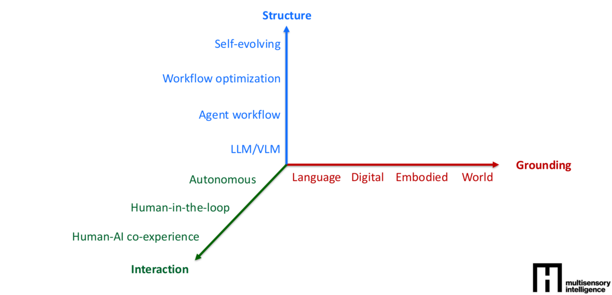

智能体系统有三个维度：

1. 反馈落地：智能体接收到的反馈是什么数据形式
2. 行为结构：如何组织智能体的行为架构
3. 交互方式：智能体如何与人类互动

> [!NOTE] 技巧
> 把一个复杂系统拆解成若干互相垂直的维度，是一种非常通用的分析手段。

多模态智能体的一个典型环境是真实网页控制任务（[VisualWebArena](https://arxiv.org/abs/2401.13649)）。在这个基准测试中，智能体需要在真实网页上执行多步操作来完成任务。下面是一个示例。

" )

常见的失败模式有两类：

1. 视觉处理失效：点错按钮或空间推理出错（例如，“第一行的商品是什么？”）。
2. 长程推理与规划失效：由于多模态输入极其消耗上下文长度，智能体很容易陷入死循环。

解决第一个问题的一个可行思路，是像图像处理那样为智能体更精细地标注 HTML 元素（[Set-of-Marks](https://arxiv.org/abs/2310.11441)）。

" )

而针对长程任务，近期的一项研究选择将历史信息压缩进“内部状态”中，思路有点类似*线性注意力*。

")

## 跨模态迁移

这一概念源于一种常见现象：来自某个模态的数据，有时能帮助另一个模态学到更好的表征或取得更高的性能。

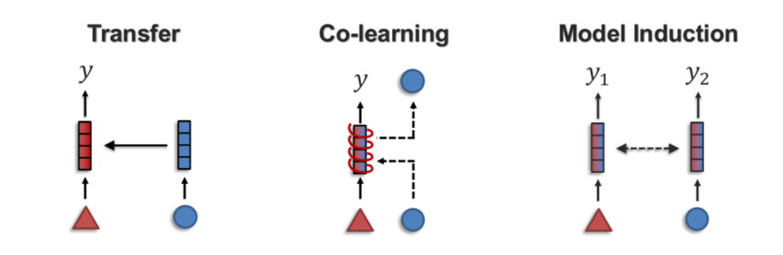

实现迁移的总体思路，就是构建一条数据通路让辅助模态参与到训练中来——可以直接与主模态数据融合，可以把辅助模态作为训练目标，也可以让两个模态各自的模型互相打标签。前面提到的各种训练方式在这里都能派上用场。

其中最值得注意的方法是模型诱导：保持各单模态模型相互独立，但诱导不同模型产生一致的行为模式。

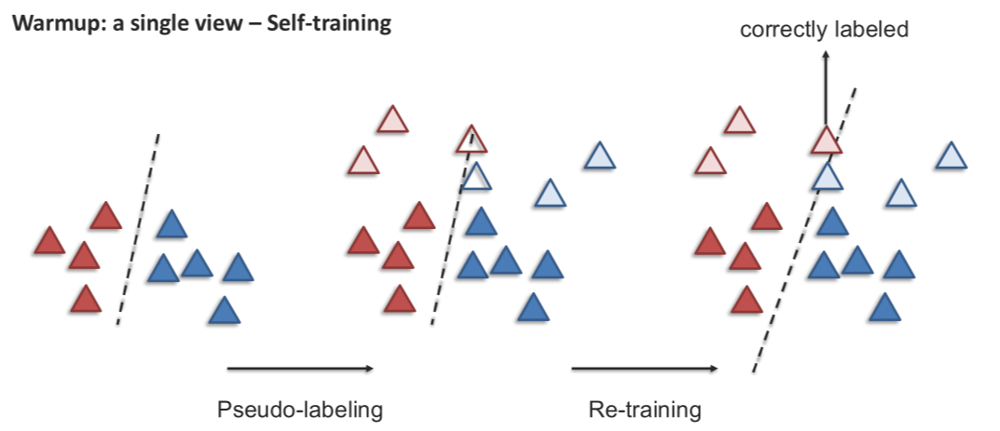

模型诱导的一种典型形式就是自训练。自训练的主体流程类似于在线策略强化学习：先在初始数据集上训练出第一代模型，再用这个模型给更多数据打上伪标签，随后用新标注的数据重新训练模型。如此往复迭代，最终就能得到比仅用原始数据训出来的基线模型强得多的结果。

## 规模定律

鉴于[规模定律]()的赫赫威名，人们自然很好奇多模态模型在规模扩张时会表现出怎样的规律。总体而言，单模态的缩放规律遵循 Chinchilla 缩放定律的形式，而多模态缩放定律则刻画了模态之间的协同与竞争关系。

" )

> 这篇论文里有不少笔误，第二个公式的最后一项实际上应该是 \((|D_i| + |D_j|)^{\beta_{i,j}}\)

早期融合和晚期融合在缩放规律上有什么区别吗？其实差别没那么大，但早期融合表现更好。

" )
